# Database Schema Documentation (`rexone-core`)

| Parameter           | Configuration                                                                                                   |
| :------------------ | :-------------------------------------------------------------------------------------------------------------- |
| **Database Engine** | PostgreSQL 18                                                                                                   |
| **Schema Version**  | `2026_09_16_173001`                                                                                             |
| **Key Conventions** | UUID v4 Primary Keys (`gen_random_uuid()`), Soft Deletion (`discard` gem), Audit Tracking (`Auditable` concern) |

### 🏛️ Mandatory Synchronization Law (LAW.md #12)

This document MUST be updated synchronously **EVERY TIME** the database schema or `ApplicationRecord` models are created, migrated, altered, or updated. Leaving `docs/SCHEMA.md` out-of-sync with migrations or models is strictly prohibited. Keep this document focused exclusively on application records (omitting background and APM tables).

---

## 1. Architectural Overview & Global Patterns

All core business models inherit from [`ApplicationRecord`](file:///Users/rex/Desktop/Dev/rexone/rexone-core/app/models/application_record.rb):

```ruby
class ApplicationRecord < ActiveRecord::Base
  primary_abstract_class
  include Discard::Model
  include Auditable

  default_scope -> { kept }
end
```

### Global Model Standards

1. **Primary Key**: UUID v4 default `gen_random_uuid()`.
2. **Soft Deletion (`Discard::Model`)**:
   - `discarded_at` timestamp: Record is hidden by default via `default_scope -> { kept }`.
   - Methods: `discard`, `undiscard`, `discarded?`, `kept?`.
   - Queries can bypass soft-deletion with `.with_discarded` or inspect soft-deleted records with `.discarded`.
3. **Auditing (`Auditable` Concern)**:
   - Tracks the actor who created, updated, discarded, or undiscarded each record via [`Current.auditor`](file:///Users/rex/Desktop/Dev/rexone/rexone-core/app/models/current.rb).
   - Foreign Keys (pointing to `users.id`):
     - `created_by_id`
     - `updated_by_id`
     - `discarded_by_id`
     - `undiscarded_by_id`
   - Timestamps: `undiscarded_at` (in addition to `discarded_at`).
4. **Agile Standard Migrations & Model Validations Doctrine (LAW C6)**:
   - **Clean Standard Migrations**: Migrations strictly define column types, nullability, foreign keys, and clean query and unique indexes.
   - **Single-Field & Composite Join Unique Indexes Permitted & Standard**:
     - Single-field natural unique keys (`ai_profiles.key`, `coupons.code`, `payment_products.code`, `assets.url`, `iam_roles.name`, `iam_permissions.name`, `client_versions.number`, `client_versions.ios_build_number`, `client_versions.android_build_number`) enforce physical table-wide uniqueness at the database level.
     - Composite join/association unique keys (`iam_role_permissions [role_id, permission_id]`, `iam_user_roles [user_id, role_id]`, `iam_permissions [resource, action]`, `client_user_versions [user_id, platform]`) are standard and prevent duplicate join relations in the database.
     - Complex domain entitlements (`accesses [user_id, product_id]`, `user_notifications [user_id, operation_id]`) utilize clean standard query indexes with lifecycle uniqueness managed in Rails models.
   - **Zero Raw SQL Partial Indexes**: Raw SQL `WHERE` clauses (e.g. `where: "discarded_at IS NULL"`) in migrations are prohibited.
   - **Zero Sequence/Reordering Collisions**: Multi-column sequence unique indexes on ordering/positional columns are banned to prevent drag-and-drop / re-indexing deadlocks.
   - **Model-Led Business Validation Authority**: Model validations enforce uniqueness across all records (including discarded/recycled records). This ensures administrators are immediately alerted if an entity already exists in the Recycle Bin ("has already been taken"), prompting them to restore it (`undiscard`) or permanently purge it from the bin (`destroy`) before creating a duplicate.
5. **Scope of this Document**:
   - Covers only **Application Records** representing business entities.
   - **Explicitly Excluded**: Background engine & telemetry tables (Solid Queue, Solid Cable, Solid Cache, Rails Pulse, and Rails Error Dashboard). See [Excluded Infrastructure Tables](#excluded-infrastructure-tables).

---

## 2. Entity-Relationship (ER) Diagram

```mermaid
erDiagram
  users ||--o{ iam_user_roles : "assigned"
  iam_roles ||--o{ iam_user_roles : "granted_to"
  iam_roles ||--o{ iam_role_permissions : "contains"
  iam_permissions ||--o{ iam_role_permissions : "included_in"

  users ||--o{ payment_subscriptions : "subscribes"
  users ||--o{ payment_purchases : "pays"
  users ||--o{ accesses : "holds"
  users ||--o{ coupons : "refers"
  users ||--o{ user_coupons : "redeems"
  payment_products ||--o{ payment_subscriptions : "defines_tier"
  payment_products ||--o{ payment_purchases : "purchased_in"
  payment_products ||--o{ accesses : "grants_access_to"
  payment_products ||--o{ user_coupons : "applied_to"
  coupons ||--o{ user_coupons : "tracks_redemptions"

  users ||--o{ chat_rooms : "owns"
  chat_rooms ||--o{ chat_messages : "contains"
  ai_profiles ||--o{ chat_messages : "controls"
  ai_profiles ||--o{ ai_runs : "records"
  users ||--o{ ai_runs : "executes"
  chat_messages ||--o{ ai_runs : "traces"

  users ||--o{ feedbacks : "submits"
  users ||--o{ client_logs : "originates"

  lessons {
    uuid id PK
    string title
    integer level
    string unit
    string status
    jsonb story_order
    jsonb build_the_sentences
  }
  lessons ||--o| assets : "song assetable"
  lessons ||--o{ vocabularies : "lesson list (choice_id null)"
  lessons ||--o{ word_families : "nested"
  lessons ||--o{ questions : "questionable"
  lessons ||--o{ sort_health_choices : "healthy-choice groups"
  sort_health_choices ||--o{ vocabularies : "group items"
  questions ||--o{ question_options : "options"
  question_options ||--o| assets : "image assetable"

  campuses ||--o{ school_classes : "contains"
  campuses ||--o{ campus_memberships : "teachers"
  users ||--o{ campus_memberships : "teacher_admin"
  school_classes ||--o{ class_assignments : "teachers"
  users ||--o{ class_assignments : "teacher"
  school_classes ||--o{ class_enrollments : "enrolls"
  users ||--o{ class_enrollments : "student"
  users ||--o{ parent_students : "parent"
  users ||--o{ parent_students : "student"

  users ||--o{ user_notifications : "receives"
  notifications ||--o{ user_notifications : "templated_by"

  users ||--o{ client_user_versions : "runs"
  client_versions ||--o{ client_user_versions : "matches"
  client_versions ||--o{ feedbacks : "reports"
  client_versions ||--o{ client_logs : "reports"

  users ||--o{ assets : "assetable (polymorphic)"
  payment_products ||--o{ assets : "assetable (polymorphic)"
  chat_messages ||--o{ assets : "assetable (polymorphic)"
  vocabularies ||--o| assets : "image assetable"
```



---

## 3. Identity & Access Management (IAM)

### 3.1. `users`

- **Model**: [`User`](file:///Users/rex/Desktop/Dev/rexone/rexone-core/app/models/user.rb)
- **Description**: Core identity table managing authentication (Devise + JWT revocation with JTI), profile, confirmation, and Stripe customer linking.

| Column                   | Type       | Nullable | Default             | Description / Notes                      |
| :----------------------- | :--------- | :------: | :------------------ | :--------------------------------------- |
| `id`                     | `uuid`     |    ❌    | `gen_random_uuid()` | Primary Key                              |
| `name`                   | `string`   |    ✔️    | `NULL`              | Full display name (max 50 chars)         |
| `username`               | `string`   |    ❌    | —                   | Unique handle (`[a-z0-9_]`, 3..30 chars) |
| `email`                  | `string`   |    ❌    | `""`                | Unique email address                     |
| `encrypted_password`     | `string`   |    ❌    | `""`                | Bcrypt encrypted hash                    |
| `jti`                    | `string`   |    ❌    | —                   | Devise JWT revocation identifier         |
| `stripe_customer_id`     | `string`   |    ✔️    | `NULL`              | Stripe Customer ID (`cus_...`)           |
| `provider`               | `string`   |    ✔️    | `NULL`              | Auth provider (e.g. OAuth)               |
| `confirmation_token`     | `string`   |    ✔️    | `NULL`              | Devise confirmation token                |
| `confirmation_code`      | `string`   |    ✔️    | `NULL`              | 6-digit numeric verification code        |
| `confirmation_sent_at`   | `datetime` |    ✔️    | `NULL`              | When confirmation code was dispatched    |
| `confirmed_at`           | `datetime` |    ✔️    | `NULL`              | When account email was confirmed         |
| `unconfirmed_email`      | `string`   |    ✔️    | `NULL`              | Pending new email address                |
| `reset_password_token`   | `string`   |    ✔️    | `NULL`              | Password recovery token                  |
| `reset_password_sent_at` | `datetime` |    ✔️    | `NULL`              | Password recovery timestamp              |
| `remember_created_at`    | `datetime` |    ✔️    | `NULL`              | Devise remember me timestamp             |
| `sign_in_count`          | `integer`  |    ❌    | `0`                 | Total sign-ins counter                   |
| `current_sign_in_at`     | `datetime` |    ✔️    | `NULL`              | Current session start                    |
| `last_sign_in_at`        | `datetime` |    ✔️    | `NULL`              | Previous session start                   |
| `current_sign_in_ip`     | `string`   |    ✔️    | `NULL`              | Current IP address                       |
| `last_sign_in_ip`        | `string`   |    ✔️    | `NULL`              | Previous IP address                      |
| `failed_attempts`        | `integer`  |    ❌    | `0`                 | Consecutive failed login attempts        |
| `unlock_token`           | `string`   |    ✔️    | `NULL`              | Account lock release token               |
| `locked_at`              | `datetime` |    ✔️    | `NULL`              | Account lock timestamp                   |
| `created_by_id`          | `uuid`     |    ✔️    | `NULL`              | Auditing: Creator                        |
| `updated_by_id`          | `uuid`     |    ✔️    | `NULL`              | Auditing: Modifier                       |
| `discarded_by_id`        | `uuid`     |    ✔️    | `NULL`              | Auditing: Discarder                      |
| `undiscarded_by_id`      | `uuid`     |    ✔️    | `NULL`              | Auditing: Restorer                       |
| `discarded_at`           | `datetime` |    ✔️    | `NULL`              | Soft delete timestamp                    |
| `undiscarded_at`         | `datetime` |    ✔️    | `NULL`              | Soft delete restoration timestamp        |
| `created_at`             | `datetime` |    ❌    | —                   | Timestamp                                |
| `updated_at`             | `datetime` |    ❌    | —                   | Timestamp                                |

**Indexes**:

- `index_users_on_email` (UNIQUE: `email`)
- `index_users_on_username` (UNIQUE: `username`)
- `index_users_on_jti` (UNIQUE: `jti`)
- `index_users_on_confirmation_token` (UNIQUE: `confirmation_token`)
- `index_users_on_reset_password_token` (UNIQUE: `reset_password_token`)
- `index_users_on_unlock_token` (UNIQUE: `unlock_token`)
- `index_users_on_discarded_at` (`discarded_at`)
- `index_users_on_created_by_id`, `updated_by_id`, `discarded_by_id`, `undiscarded_by_id`

**Foreign Keys**:

- Self-referencing FKs for `created_by_id`, `updated_by_id`, `discarded_by_id`, `undiscarded_by_id` -> `users(id)`.

**API representation and lifecycle invariants**:

- `UserSerializer` embeds the current IAM snapshot under `iam`: admin flags plus all/admin/non-admin role and permission collections. The current-user API therefore has no separate IAM aggregate endpoint.
- Super-admin accounts cannot be discarded.
- Discarded user accounts are rejected from authentication (`active_for_authentication?` returns `false` with `:inactive` message), their `jti` is rotated, and active platform sessions are evicted from Redis upon discard.

---

### 3.2. `iam_roles`

- **Model**: [`Iam::Role`](file:///Users/rex/Desktop/Dev/rexone/rexone-core/app/models/iam/role.rb)
- **Description**: RBAC roles (e.g. `super_admin`, `admin`, `user`, `student`, `parent`, `teacher_admin`).

| Column              | Type       | Nullable | Default             | Description / Notes                             |
| :------------------ | :--------- | :------: | :------------------ | :---------------------------------------------- |
| `id`                | `uuid`     |    ❌    | `gen_random_uuid()` | Primary Key                                     |
| `name`              | `string`   |    ❌    | —                   | Role name (e.g. `super_admin`, `admin`, `user`, `student`, `parent`, `teacher_admin`) |
| `description`       | `text`     |    ✔️    | `NULL`              | Human-readable role description                 |
| `system`            | `boolean`  |    ✔️    | `false`             | Protected system role flag                      |
| `created_by_id`     | `uuid`     |    ✔️    | `NULL`              | Auditing: Creator                               |
| `updated_by_id`     | `uuid`     |    ✔️    | `NULL`              | Auditing: Modifier                              |
| `discarded_by_id`   | `uuid`     |    ✔️    | `NULL`              | Auditing: Discarder                             |
| `undiscarded_by_id` | `uuid`     |    ✔️    | `NULL`              | Auditing: Restorer                              |
| `discarded_at`      | `datetime` |    ✔️    | `NULL`              | Soft delete timestamp                           |
| `undiscarded_at`    | `datetime` |    ✔️    | `NULL`              | Soft delete restoration timestamp               |
| `created_at`        | `datetime` |    ❌    | —                   | Timestamp                                       |
| `updated_at`        | `datetime` |    ❌    | —                   | Timestamp                                       |

**Indexes**:

- `index_iam_roles_on_name` (`name`, unique)
- `index_iam_roles_on_discarded_at` (`discarded_at`)
- Auditing indexes on `created_by_id`, `updated_by_id`, `discarded_by_id`, `undiscarded_by_id`.

---

### 3.3. `iam_permissions`

- **Model**: [`Iam::Permission`](file:///Users/rex/Desktop/Dev/rexone/rexone-core/app/models/iam/permission.rb)
- **Description**: Granular permissions composed of an action (`read`, `create`, `update`, `delete`) and a resource.

| Column              | Type       | Nullable | Default             | Description / Notes                                                                                                                                                                                                                                                                                                                                                                                                       |
| :------------------ | :--------- | :------: | :------------------ | :------------------------------------------------------------------------------------------------------------------------------------------------------------------------------------------------------------------------------------------------------------------------------------------------------------------------------------------------------------------------------------------------------------------------ |
| `id`                | `uuid`     |    ❌    | `gen_random_uuid()` | Primary Key                                                                                                                                                                                                                                                                                                                                                                                                               |
| `name`              | `string`   |    ❌    | —                   | Unique identifier (e.g. `read_users`, `create_payments`)                                                                                                                                                                                                                                                                                                                                                                  |
| `action`            | `string`   |    ❌    | —                   | Enum: `read`, `create`, `update`, `delete`                                                                                                                                                                                                                                                                                                                                                                                |
| `resource`          | `string`   |    ❌    | —                   | Enum of canonical resources including `users`, `accesses`, `assets`, `notifications`, `user_notifications`, `feedbacks`, `lessons`, `campuses`, `school_classes`, `campus_memberships`, `class_assignments`, `class_enrollments`, `parent_students`, `analytics`, `speech`, `ai_profiles`, `ai_runs`, `chat_rooms`, `chat_messages`, `client_logs`, `client_versions`, `client_user_versions`, `iam_roles`, `iam_permissions`, `iam_user_roles`, `payment_products`, `payment_payments`, `payment_subscriptions`, `payment_purchases`, `payment_coupons`, `payment_user_coupons` |
| `created_by_id`     | `uuid`     |    ✔️    | `NULL`              | Auditing: Creator                                                                                                                                                                                                                                                                                                                                                                                                         |
| `updated_by_id`     | `uuid`     |    ✔️    | `NULL`              | Auditing: Modifier                                                                                                                                                                                                                                                                                                                                                                                                        |
| `discarded_by_id`   | `uuid`     |    ✔️    | `NULL`              | Auditing: Discarder                                                                                                                                                                                                                                                                                                                                                                                                       |
| `undiscarded_by_id` | `uuid`     |    ✔️    | `NULL`              | Auditing: Restorer                                                                                                                                                                                                                                                                                                                                                                                                        |
| `discarded_at`      | `datetime` |    ✔️    | `NULL`              | Soft delete timestamp                                                                                                                                                                                                                                                                                                                                                                                                     |
| `undiscarded_at`    | `datetime` |    ✔️    | `NULL`              | Soft delete restoration timestamp                                                                                                                                                                                                                                                                                                                                                                                         |
| `created_at`        | `datetime` |    ❌    | —                   | Timestamp                                                                                                                                                                                                                                                                                                                                                                                                                 |
| `updated_at`        | `datetime` |    ❌    | —                   | Timestamp                                                                                                                                                                                                                                                                                                                                                                                                                 |

**Indexes**:

- `index_iam_permissions_on_name` (`name`, unique)
- `index_iam_permissions_on_resource_and_action` (`resource`, `action`, unique)
- Auditing indexes on `created_by_id`, `updated_by_id`, `discarded_by_id`, `undiscarded_by_id`, `discarded_at`.

**Mutation invariants**:

- Permissions must be discarded before permanent deletion and may be restored from the recycle bin.
- A role-permission assignment belonging to `super_admin` cannot be updated or removed.

---

### 3.4. `iam_user_roles`

- **Model**: [`Iam::UserRole`](file:///Users/rex/Desktop/Dev/rexone/rexone-core/app/models/iam/user_role.rb)
- **Description**: Join table linking Users to Roles (Many-to-Many).

| Column              | Type       | Nullable | Default             | Description / Notes               |
| :------------------ | :--------- | :------: | :------------------ | :-------------------------------- |
| `id`                | `uuid`     |    ❌    | `gen_random_uuid()` | Primary Key                       |
| `user_id`           | `uuid`     |    ❌    | —                   | FK to `users.id`                  |
| `role_id`           | `uuid`     |    ❌    | —                   | FK to `iam_roles.id`              |
| `created_by_id`     | `uuid`     |    ✔️    | `NULL`              | Auditing: Creator                 |
| `updated_by_id`     | `uuid`     |    ✔️    | `NULL`              | Auditing: Modifier                |
| `discarded_by_id`   | `uuid`     |    ✔️    | `NULL`              | Auditing: Discarder               |
| `undiscarded_by_id` | `uuid`     |    ✔️    | `NULL`              | Auditing: Restorer                |
| `discarded_at`      | `datetime` |    ✔️    | `NULL`              | Soft delete timestamp             |
| `undiscarded_at`    | `datetime` |    ✔️    | `NULL`              | Soft delete restoration timestamp |
| `created_at`        | `datetime` |    ❌    | —                   | Timestamp                         |
| `updated_at`        | `datetime` |    ❌    | —                   | Timestamp                         |

**Indexes & Foreign Keys**:

- `index_iam_user_roles_on_user_id_and_role_id` (`user_id`, `role_id`, unique)
- `index_iam_user_roles_on_role_id` (`role_id`)
- `index_iam_user_roles_on_user_id` (`user_id`)
- FKs to `users(id)` and `iam_roles(id)`.

**Mutation invariants**:

- Role membership is changed only through the dedicated IAM user-role resource; admin user create/update does not accept role IDs.
- The final remaining `super_admin` assignment cannot be removed.
- System roles cannot be discarded or permanently deleted.
- The `super_admin` role's permission assignments cannot be updated or removed; newly introduced permissions may still be assigned automatically.

---

### 3.5. `iam_role_permissions`

- **Model**: [`Iam::RolePermission`](file:///Users/rex/Desktop/Dev/rexone/rexone-core/app/models/iam/role_permission.rb)
- **Description**: Join table linking Roles to Permissions (Many-to-Many).

| Column              | Type       | Nullable | Default             | Description / Notes               |
| :------------------ | :--------- | :------: | :------------------ | :-------------------------------- |
| `id`                | `uuid`     |    ❌    | `gen_random_uuid()` | Primary Key                       |
| `role_id`           | `uuid`     |    ❌    | —                   | FK to `iam_roles.id`              |
| `permission_id`     | `uuid`     |    ❌    | —                   | FK to `iam_permissions.id`        |
| `created_by_id`     | `uuid`     |    ✔️    | `NULL`              | Auditing: Creator                 |
| `updated_by_id`     | `uuid`     |    ✔️    | `NULL`              | Auditing: Modifier                |
| `discarded_by_id`   | `uuid`     |    ✔️    | `NULL`              | Auditing: Discarder               |
| `undiscarded_by_id` | `uuid`     |    ✔️    | `NULL`              | Auditing: Restorer                |
| `discarded_at`      | `datetime` |    ✔️    | `NULL`              | Soft delete timestamp             |
| `undiscarded_at`    | `datetime` |    ✔️    | `NULL`              | Soft delete restoration timestamp |
| `created_at`        | `datetime` |    ❌    | —                   | Timestamp                         |
| `updated_at`        | `datetime` |    ❌    | —                   | Timestamp                         |

**Indexes & Foreign Keys**:

- `index_iam_role_permissions_on_role_id_and_permission_id` (`role_id`, `permission_id`, unique)
- `index_iam_role_permissions_on_role_id` (`role_id`)
- `index_iam_role_permissions_on_permission_id` (`permission_id`)
- FKs to `iam_roles(id)` and `iam_permissions(id)`.

---

## 4. Payments, Subscriptions & Products

### 4.1. `payment_products`

- **Model**: [`Payment::Product`](file:///Users/rex/Desktop/Dev/rexone/rexone-core/app/models/payment/product.rb)
- **Description**: Catalog of purchasable tiers and items across payment providers (Stripe, Google Play, Apple App Store) or free products.

| Column                   | Type       | Nullable | Default             | Description / Notes                                                                                         |
| :----------------------- | :--------- | :------: | :------------------ | :---------------------------------------------------------------------------------------------------------- |
| `id`                     | `uuid`     |    ❌    | `gen_random_uuid()` | Primary Key                                                                                                 |
| `code`                   | `string`   |    ❌    | —                   | Immutable unique product code (10 alphanumeric chars)                                                       |
| `name`                   | `string`   |    ❌    | —                   | Product display name                                                                                        |
| `description`            | `text`     |    ✔️    | `NULL`              | Marketing / plan description                                                                                |
| `unit_amount`            | `integer`  |    ❌    | —                   | Price in smallest currency unit (cents, 0 = Free)                                                           |
| `currency`               | `string`   |    ❌    | —                   | Currency code (e.g. `usd`)                                                                                  |
| `interval`               | `string`   |    ✔️    | `NULL`              | Billing interval: `day`, `week`, `month`, `year`, or `NULL` (one-time / free)                               |
| `active`                 | `boolean`  |    ❌    | `true`              | Availability status                                                                                         |
| `stripe_product_id`      | `string`   |    ✔️    | `NULL`              | Stripe product identifier (`prod_...`). NULL if unavailable on Stripe / free                                |
| `stripe_price_id`        | `string`   |    ✔️    | `NULL`              | Stripe price/plan identifier (`price_...`). NULL if unavailable on Stripe / free                            |
| `google_play_product_id` | `string`   |    ✔️    | `NULL`              | Google Play product/SKU identifier (e.g. `com.rexone.pro.monthly`). NULL if unavailable on Play Store       |
| `app_store_product_id`   | `string`   |    ✔️    | `NULL`              | Apple App Store product/in-app identifier (e.g. `com.rexone.pro.monthly`). NULL if unavailable on App Store |
| `created_by_id`          | `uuid`     |    ✔️    | `NULL`              | Auditing: Creator                                                                                           |
| `updated_by_id`          | `uuid`     |    ✔️    | `NULL`              | Auditing: Modifier                                                                                          |
| `discarded_by_id`        | `uuid`     |    ✔️    | `NULL`              | Auditing: Discarder                                                                                         |
| `undiscarded_by_id`      | `uuid`     |    ✔️    | `NULL`              | Auditing: Restorer                                                                                          |
| `discarded_at`           | `datetime` |    ✔️    | `NULL`              | Soft delete timestamp                                                                                       |
| `undiscarded_at`         | `datetime` |    ✔️    | `NULL`              | Soft delete restoration timestamp                                                                           |
| `created_at`             | `datetime` |    ❌    | —                   | Timestamp                                                                                                   |
| `updated_at`             | `datetime` |    ❌    | —                   | Timestamp                                                                                                   |

**Indexes**:

- `index_payment_products_on_code` (`code`, unique)
- `index_payment_products_on_stripe_product_id` (`stripe_product_id`, unique)
- `index_payment_products_on_stripe_price_id` (`stripe_price_id`, unique)
- `index_payment_products_on_google_play_product_id` (`google_play_product_id`, unique)
- `index_payment_products_on_app_store_product_id` (`app_store_product_id`, unique)
- `index_payment_products_on_discarded_at` (`discarded_at`)

---

### 4.2. `payment_subscriptions`

- **Model**: [`Payment::Subscription`](file:///Users/rex/Desktop/Dev/rexone/rexone-core/app/models/payment/subscription.rb)
- **Description**: Recurring user subscription instances across payment providers (Stripe, Google Play, Apple App Store).

| Column                          | Type       | Nullable | Default             | Description / Notes                                                        |
| :------------------------------ | :--------- | :------: | :------------------ | :------------------------------------------------------------------------- |
| `id`                            | `uuid`     |    ❌    | `gen_random_uuid()` | Primary Key                                                                |
| `user_id`                       | `uuid`     |    ❌    | —                   | FK to `users.id`                                                           |
| `product_id`                    | `uuid`     |    ❌    | —                   | FK to `payment_products.id`                                                |
| `provider`                      | `string`   |    ❌    | `"stripe"`          | Payment provider: `stripe`, `google_play`, `app_store`                     |
| `provider_subscription_id`      | `string`   |    ❌    | —                   | Universal provider subscription identifier (e.g. `sub_...` or store token) |
| `provider_customer_id`          | `string`   |    ✔️    | `NULL`              | Provider Customer ID (e.g. `cus_...`)                                      |
| `provider_subscription_item_id` | `string`   |    ✔️    | `NULL`              | Provider Subscription Item ID (e.g. `si_...`)                              |
| `provider_price_id`             | `string`   |    ✔️    | `NULL`              | Universal provider price / plan identifier (e.g. `price_...`)              |
| `status`                        | `string`   |    ❌    | `"incomplete"`      | Status: `incomplete`, `active`, `past_due`, `canceled`, `trialing`, etc.   |
| `currency`                      | `string`   |    ❌    | —                   | Lowercase ISO currency code                                                |
| `unit_amount`                   | `integer`  |    ❌    | —                   | Price snapshot in minor currency units                                     |
| `quantity`                      | `integer`  |    ❌    | `1`                 | Subscription item quantity                                                 |
| `interval`                      | `string`   |    ❌    | —                   | Recurring interval: `day`, `week`, `month`, or `year`                      |
| `interval_count`                | `integer`  |    ❌    | `1`                 | Number of intervals between billings                                       |
| `current_period_start`          | `datetime` |    ❌    | —                   | Subscription period start in UTC                                           |
| `current_period_end`            | `datetime` |    ❌    | —                   | Subscription period end in UTC                                             |
| `started_at`                    | `datetime` |    ❌    | —                   | Subscription start timestamp in UTC                                        |
| `ended_at`                      | `datetime` |    ✔️    | `NULL`              | When subscription ceased                                                   |
| `cancel_at`                     | `datetime` |    ✔️    | `NULL`              | Scheduled future cancellation time                                         |
| `canceled_at`                   | `datetime` |    ✔️    | `NULL`              | Timestamp cancellation was requested                                       |
| `cancel_at_period_end`          | `boolean`  |    ❌    | `false`             | Whether cancel occurs at period boundary                                   |
| `payment_method_id`             | `string`   |    ✔️    | `NULL`              | Payment method identifier                                                  |
| `payment_method_type`           | `string`   |    ✔️    | `NULL`              | Payment method type (e.g. `card`, `in_app`)                                |
| `payment_method_details`        | `jsonb`    |    ✔️    | `{}`                | Brand, last4, provider details                                             |
| `metadata`                      | `jsonb`    |    ✔️    | `{}`                | Metadata payload                                                           |
| `created_by_id`                 | `uuid`     |    ✔️    | `NULL`              | Auditing: Creator                                                          |
| `updated_by_id`                 | `uuid`     |    ✔️    | `NULL`              | Auditing: Modifier                                                         |
| `discarded_by_id`               | `uuid`     |    ✔️    | `NULL`              | Auditing: Discarder                                                        |
| `undiscarded_by_id`             | `uuid`     |    ✔️    | `NULL`              | Auditing: Restorer                                                         |
| `discarded_at`                  | `datetime` |    ✔️    | `NULL`              | Soft delete timestamp                                                      |
| `undiscarded_at`                | `datetime` |    ✔️    | `NULL`              | Soft delete restoration timestamp                                          |
| `created_at`                    | `datetime` |    ❌    | —                   | Timestamp                                                                  |
| `updated_at`                    | `datetime` |    ❌    | —                   | Timestamp                                                                  |

**Indexes & Foreign Keys**:

- `index_payment_subscriptions_on_provider_and_provider_sub_id` (UNIQUE: `["provider", "provider_subscription_id"]`)
- `index_payment_subscriptions_on_provider_subscription_item_id` (`provider_subscription_item_id`)
- `index_payment_subscriptions_on_provider_price_id` (`provider_price_id`)
- `index_payment_subscriptions_on_provider` (`provider`)
- `index_payment_subscriptions_on_user_id_and_status` (`user_id`, `status`)
- `index_payment_subscriptions_on_user_id` (`user_id`)
- `index_payment_subscriptions_on_product_id` (`product_id`)
- `index_payment_subscriptions_on_status` (`status`)
- `index_payment_subscriptions_on_current_period_end` (`current_period_end`)
- FKs to `users(id)` and `payment_products(id)`.

Subscription synchronization supports Stripe, Google Play, and Apple App Store. Integer price fields are stored as a subscription snapshot rather than read later from the mutable product row. Decimal prices are intentionally unsupported.

---

### 4.3. `payment_purchases`

- **Model**: [`Payment::Purchase`](file:///Users/rex/Desktop/Dev/rexone/rexone-core/app/models/payment/purchase.rb)
- **Description**: One-time purchases across payment providers (Stripe, Google Play, Apple App Store).

| Column                   | Type       | Nullable | Default                     | Description / Notes                                    |
| :----------------------- | :--------- | :------: | :-------------------------- | :----------------------------------------------------- |
| `id`                     | `uuid`     |    ❌    | `gen_random_uuid()`         | Primary Key                                            |
| `user_id`                | `uuid`     |    ❌    | —                           | FK to `users.id`                                       |
| `product_id`             | `uuid`     |    ❌    | —                           | FK to `payment_products.id`                            |
| `provider`               | `string`   |    ❌    | `"stripe"`                  | Payment provider: `stripe`, `google_play`, `app_store` |
| `provider_payment_id`    | `string`   |    ❌    | —                           | Universal provider payment/order/transaction ID        |
| `provider_charge_id`     | `string`   |    ✔️    | `NULL`                      | Universal provider charge identifier                   |
| `provider_customer_id`   | `string`   |    ✔️    | `NULL`                      | Universal provider customer identifier                 |
| `client_secret`          | `string`   |    ✔️    | `NULL`                      | Client secret for frontend SDK                         |
| `unit_amount`            | `integer`  |    ❌    | —                           | Amount in minor currency units                         |
| `amount_received`        | `integer`  |    ✔️    | `0`                         | Actual captured amount in cents                        |
| `amount_capturable`      | `integer`  |    ✔️    | `0`                         | Authorized amount ready for capture                    |
| `currency`               | `string`   |    ❌    | —                           | Currency code (e.g. `usd`)                             |
| `status`                 | `string`   |    ❌    | `"requires_payment_method"` | Payment status: `succeeded`, `processing`, etc.        |
| `payment_method_id`      | `string`   |    ✔️    | `NULL`                      | Payment method identifier                              |
| `payment_method_type`    | `string`   |    ✔️    | `NULL`                      | Payment method category (e.g. `card`, `in_app`)        |
| `payment_method_details` | `jsonb`    |    ✔️    | `{}`                        | Detailed payment summary                               |
| `processing_at`          | `datetime` |    ✔️    | `NULL`                      | When processing began                                  |
| `paid_at`                | `datetime` |    ✔️    | `NULL`                      | When payment succeeded                                 |
| `canceled_at`            | `datetime` |    ✔️    | `NULL`                      | When payment was canceled                              |
| `refunded_at`            | `datetime` |    ✔️    | `NULL`                      | When purchase was refunded                             |
| `metadata`               | `jsonb`    |    ✔️    | `{}`                        | Arbitrary metadata payload                             |
| `created_by_id`          | `uuid`     |    ✔️    | `NULL`                      | Auditing: Creator                                      |
| `updated_by_id`          | `uuid`     |    ✔️    | `NULL`                      | Auditing: Modifier                                     |
| `discarded_by_id`        | `uuid`     |    ✔️    | `NULL`                      | Auditing: Discarder                                    |
| `undiscarded_by_id`      | `uuid`     |    ✔️    | `NULL`                      | Auditing: Restorer                                     |
| `discarded_at`           | `datetime` |    ✔️    | `NULL`                      | Soft delete timestamp                                  |
| `undiscarded_at`         | `datetime` |    ✔️    | `NULL`                      | Soft delete restoration timestamp                      |
| `created_at`             | `datetime` |    ❌    | —                           | Timestamp                                              |
| `updated_at`             | `datetime` |    ❌    | —                           | Timestamp                                              |

**Indexes & Foreign Keys**:

- `index_payment_purchases_on_provider_and_provider_payment_id` (UNIQUE: `["provider", "provider_payment_id"]`)
- `index_payment_purchases_on_provider_charge_id` (UNIQUE: `provider_charge_id`)
- `index_payment_purchases_on_provider` (`provider`)
- `index_payment_purchases_on_user_id_and_created_at` (`user_id`, `created_at`)
- `index_payment_purchases_on_user_id` (`user_id`)
- `index_payment_purchases_on_product_id` (`product_id`)
- `index_payment_purchases_on_status` (`status`)
- `index_payment_purchases_on_payment_method_type` (`payment_method_type`)
- FKs to `users(id)` and `payment_products(id)`.

---

### 4.4. `payment_webhook_events`

- **Model**: [`Payment::WebhookEvent`](file:///Users/rex/Desktop/Dev/rexone/rexone-core/app/models/payment/webhook_event.rb)
- **Description**: Idempotent audit log and processing buffer for incoming webhook payloads across payment providers (Stripe, Google Play, Apple App Store).

| Column                  | Type       | Nullable | Default             | Description / Notes                            |
| :---------------------- | :--------- | :------: | :------------------ | :--------------------------------------------- |
| `id`                    | `uuid`     |    ❌    | `gen_random_uuid()` | Primary Key                                    |
| `provider`              | `string`   |    ❌    | `"stripe"`          | Provider: `stripe`, `google_play`, `app_store` |
| `provider_event_id`     | `string`   |    ❌    | —                   | Unique provider event ID (e.g. `evt_...`)      |
| `event_type`            | `string`   |    ❌    | —                   | Provider event name (e.g. `invoice.paid`)      |
| `status`                | `string`   |    ❌    | `"pending"`         | `pending`, `processing`, `processed`, `failed` |
| `livemode`              | `boolean`  |    ❌    | `false`             | True if production mode                        |
| `payload`               | `jsonb`    |    ❌    | `{}`                | Complete raw event payload                     |
| `attempt_count`         | `integer`  |    ❌    | `0`                 | Number of processing attempts                  |
| `received_at`           | `datetime` |    ❌    | —                   | When HTTP webhook was received                 |
| `processing_started_at` | `datetime` |    ✔️    | `NULL`              | Processing dispatch start                      |
| `processed_at`          | `datetime` |    ✔️    | `NULL`              | Successful completion time                     |
| `last_error`            | `text`     |    ✔️    | `NULL`              | Backtrace/error of failed execution            |
| `created_by_id`         | `uuid`     |    ✔️    | `NULL`              | Auditing: Creator                              |
| `updated_by_id`         | `uuid`     |    ✔️    | `NULL`              | Auditing: Modifier                             |
| `discarded_by_id`       | `uuid`     |    ✔️    | `NULL`              | Auditing: Discarder                            |
| `undiscarded_by_id`     | `uuid`     |    ✔️    | `NULL`              | Auditing: Restorer                             |
| `discarded_at`          | `datetime` |    ✔️    | `NULL`              | Soft delete timestamp                          |
| `undiscarded_at`        | `datetime` |    ✔️    | `NULL`              | Soft delete restoration timestamp              |
| `created_at`            | `datetime` |    ❌    | —                   | Timestamp                                      |
| `updated_at`            | `datetime` |    ❌    | —                   | Timestamp                                      |

**Indexes**:

- `index_payment_webhook_events_on_provider_event_id` (UNIQUE: `provider_event_id`)
- `index_payment_webhook_events_on_provider` (`provider`)
- `index_payment_webhook_events_on_status_and_received_at` (`status`, `received_at`)
- `index_payment_webhook_events_on_event_type` (`event_type`)
- `index_payment_webhook_events_on_received_at` (`received_at`)

---

### 4.5. `coupons`

- **Model**: [`Payment::Coupon`](file:///Users/rex/Desktop/Dev/rexone/rexone-core/app/models/payment/coupon.rb)
- **Description**: Promotional discount codes and user referral coupons that can be applied during checkout. Supports percentage or fixed-amount discounts, currency restrictions, global and per-user redemption limits, expiration dates, and multi-tenant targeting restrictions (`target_role_ids`, `target_user_ids`, `target_product_ids`).

| Column               | Type       | Nullable | Default             | Description / Notes                                           |
| :------------------- | :--------- | :------: | :------------------ | :------------------------------------------------------------ |
| `id`                 | `uuid`     |    ❌    | `gen_random_uuid()` | Primary Key                                                   |
| `title`              | `string`   |    ❌    | —                   | Marketing title / description of the promotion                |
| `description`        | `text`     |    ✔️    | `NULL`              | Detailed promo terms or campaign notes                        |
| `code`               | `string`   |    ❌    | —                   | Uppercase unique promo code (e.g. `SAVE20`, `REF-ALICE`)      |
| `coupon_type`        | `integer`  |    ❌    | `0`                 | Enum: `0: percentage` (1-100%), `1: fixed` (minor units)      |
| `amount`             | `integer`  |    ❌    | —                   | Discount magnitude: percentage (1-100) or fixed minor units   |
| `currency`           | `string`   |    ✔️    | `NULL`              | Minor units currency (e.g. `usd`). Nullable for percentage    |
| `metadata`           | `jsonb`    |    ❌    | `{}`                | Arbitrary JSONB metadata payload                              |
| `max_usage`          | `integer`  |    ❌    | `0`                 | Total allowable redemptions across all users (0 = unlimited)  |
| `max_usage_per_user` | `integer`  |    ❌    | `1`                 | Maximum redemptions per individual user                       |
| `used_count`         | `integer`  |    ❌    | `0`                 | Atomic redemption counter (reconciled by weekly DataSync)     |
| `expires_at`         | `datetime` |    ✔️    | `NULL`              | UTC expiration timestamp (NULL = never expires)               |
| `referrer_id`        | `uuid`     |    ✔️    | `NULL`              | FK to `users.id` (user whose referral code this is)           |
| `target_role_ids`    | `uuid[]`   |    ❌    | `[]`                | Array of `iam_roles.id` that are eligible                     |
| `target_user_ids`    | `uuid[]`   |    ❌    | `[]`                | Array of `users.id` that are eligible                         |
| `target_product_ids` | `uuid[]`   |    ❌    | `[]`                | Array of `payment_products.id` that are eligible              |
| `provider`           | `string`   |    ❌    | `"stripe"`          | Payment provider identifier (`stripe`)                        |
| `provider_coupon_id` | `string`   |    ✔️    | `NULL`              | Remote provider coupon identifier (e.g. Stripe coupon ID)     |
| `active`             | `boolean`  |    ❌    | `true`              | Operational availability flag (deactivated upon soft-discard) |
| `created_by_id`      | `uuid`     |    ✔️    | `NULL`              | Auditing: Creator                                             |
| `updated_by_id`      | `uuid`     |    ✔️    | `NULL`              | Auditing: Modifier                                            |
| `discarded_by_id`    | `uuid`     |    ✔️    | `NULL`              | Auditing: Discarder                                           |
| `undiscarded_by_id`  | `uuid`     |    ✔️    | `NULL`              | Auditing: Restorer                                            |
| `discarded_at`       | `datetime` |    ✔️    | `NULL`              | Soft delete timestamp                                         |
| `undiscarded_at`     | `datetime` |    ✔️    | `NULL`              | Soft delete restoration timestamp                             |
| `created_at`         | `datetime` |    ❌    | —                   | Timestamp                                                     |
| `updated_at`         | `datetime` |    ❌    | —                   | Timestamp                                                     |

**Indexes & Foreign Keys**:

- `index_coupons_on_code` (`code`, unique)
- `index_coupons_on_provider_coupon_id` (`provider_coupon_id`)
- `index_coupons_on_provider` (`provider`)
- `index_coupons_on_referrer_id` (`referrer_id`)
- `index_coupons_on_expires_at` (`expires_at`)
- `index_coupons_on_coupon_type` (`coupon_type`)
- `index_coupons_on_discarded_at` (`discarded_at`)
- `index_coupons_on_target_role_ids` (`target_role_ids`, GIN)
- `index_coupons_on_target_user_ids` (`target_user_ids`, GIN)
- `index_coupons_on_target_product_ids` (`target_product_ids`, GIN)
- FK to `users(id)` via `referrer_id`.

**Stripe Synchronization & Immutability Invariants**:

- **Immutability of Financial Terms**: Financial parameters (`code`, `coupon_type`, `amount`, `currency`, `max_usage`, `expires_at`) are strictly immutable once created, ensuring deterministic parity with Stripe coupons. To alter terms, coupons must be destroyed and recreated.
- **Bi-Directional Metadata Sync**: `metadata` JSONB is converted to string maps and synced to Stripe upon creation and update.
- **Soft Delete vs Hard Delete**:
  - Soft-delete (`discard`) is purely local (sets `active = false` and blocks redemptions) so Stripe does not permanently burn the coupon ID, preserving restoration (`undiscard`) capabilities.
  - Hard-delete (`destroy`) permanently destroys both local DB records and remote Stripe coupons.
  - Inbound `coupon.deleted` webhooks from Stripe permanently destroy the local DB coupon (`coupon.destroy!`) to prevent accidental redemptions.
- **Batch Generation & Asynchronous Stripe Sync**:
  - Batch coupon creation (`POST /v1/admin/payment/coupons/batch`) creates up to 100 coupons per batch (configurable via `AppConfig::PAYMENT_BATCH_COUPON_LIMIT`, default 100).
  - All batch coupons are initially persisted with `active: false` and `metadata.status = "processing"`.
  - Stripe registration is enqueued asynchronously in slices of 50 via [`Payment::SyncBatchCouponsJob`](file:///Users/rex/Desktop/Dev/rexone/rexone-core/app/jobs/payment/sync_batch_coupons_job.rb) on queue `:payments`.
  - Successful coupons are set to `active: true` with `metadata.status = "succeeded"`.
  - Coupons that fail registration (or exhaust retries) remain permanently `active: false` with `metadata.status = "failed"` and `metadata.sync_error`.
  - Failed coupons cannot be manually updated to `active: true` (enforced via model validation `validate_failed_status_cannot_be_active`). Admins can inspect the error and hard delete them if appropriate.
- **Referral Coupon Auto-Creation & Third-Party Cleanup Cascade**:
  - Upon user registration, a default referral coupon (`REF<USERNAME>`, 10% off) is automatically generated for the user (`User#create_default_referral_coupon`).
  - When a user is deleted (`user.destroy`), all associated `referred_coupons` are destroyed via `dependent: :destroy`, which in turn triggers `Payment::Coupon#after_destroy` to permanently delete the remote Stripe coupon.
  - `User#after_destroy` automatically deletes the associated remote Stripe customer (`Stripe::Customer.delete`) if `stripe_customer_id` is present.
  - `Payment::Subscription#after_destroy` automatically cancels the remote Stripe subscription (`Stripe::Subscription.cancel`).
  - `Asset#after_destroy_commit` purges physical files from Garage S3 storage (`StorageService::Client.delete(storage_key)`).
  - This ensures zero orphaned resources on third-party providers (Stripe, Garage) during user cleanup, database pruning, integration tests, and e2e testing suites.

---

### 4.6. `user_coupons`

- **Model**: [`Payment::UserCoupon`](file:///Users/rex/Desktop/Dev/rexone/rexone-core/app/models/payment/user_coupon.rb)
- **Description**: Immutable audit ledger recording each coupon redemption associated with a purchase or subscription.

| Column              | Type       | Nullable | Default             | Description / Notes                                        |
| :------------------ | :--------- | :------: | :------------------ | :--------------------------------------------------------- |
| `id`                | `uuid`     |    ❌    | `gen_random_uuid()` | Primary Key                                                |
| `coupon_id`         | `uuid`     |    ❌    | —                   | FK to `coupons.id`                                         |
| `user_id`           | `uuid`     |    ❌    | —                   | FK to `users.id`                                           |
| `product_id`        | `uuid`     |    ❌    | —                   | FK to `payment_products.id`                                |
| `payment_id`        | `uuid`     |    ❌    | —                   | FK to `payment_purchases.id` or `payment_subscriptions.id` |
| `payment_type`      | `integer`  |    ❌    | `0`                 | Enum: `0: purchase`, `1: subscription`                     |
| `discount_amount`   | `integer`  |    ❌    | `0`                 | Actual discount deducted in minor currency units           |
| `original_amount`   | `integer`  |    ❌    | `0`                 | Product original price before discount                     |
| `final_amount`      | `integer`  |    ❌    | `0`                 | Net amount billed after coupon discount                    |
| `currency`          | `string`   |    ❌    | `"usd"`             | Currency identifier (e.g. `usd`, `mmk`, `sgd`)             |
| `created_by_id`     | `uuid`     |    ✔️    | `NULL`              | Auditing: Creator                                          |
| `updated_by_id`     | `uuid`     |    ✔️    | `NULL`              | Auditing: Modifier                                         |
| `discarded_by_id`   | `uuid`     |    ✔️    | `NULL`              | Auditing: Discarder                                        |
| `undiscarded_by_id` | `uuid`     |    ✔️    | `NULL`              | Auditing: Restorer                                         |
| `discarded_at`      | `datetime` |    ✔️    | `NULL`              | Soft delete timestamp                                      |
| `undiscarded_at`    | `datetime` |    ✔️    | `NULL`              | Soft delete restoration timestamp                          |
| `created_at`        | `datetime` |    ❌    | —                   | Timestamp                                                  |
| `updated_at`        | `datetime` |    ❌    | —                   | Timestamp                                                  |

**Indexes & Foreign Keys**:

- `index_user_coupons_on_payment_id_and_payment_type` (`payment_id`, `payment_type`)
- `index_user_coupons_on_coupon_id_and_user_id` (`coupon_id`, `user_id`)
- `index_user_coupons_on_discarded_at` (`discarded_at`)
- FKs to `coupons(id)`, `users(id)`, and `payment_products(id)`.

---

## 5. Product Access & Entitlements

### 5.1. `accesses`

- **Model**: [`Access`](file:///Users/rex/Desktop/Dev/rexone/rexone-core/app/models/access.rb)
- **Description**: Grants a User active entitlement to a Product (subscription-based or permanent).

| Column              | Type       | Nullable | Default             | Description / Notes                           |
| :------------------ | :--------- | :------: | :------------------ | :-------------------------------------------- |
| `id`                | `uuid`     |    ❌    | `gen_random_uuid()` | Primary Key                                   |
| `user_id`           | `uuid`     |    ❌    | —                   | FK to `users.id`                              |
| `product_id`        | `uuid`     |    ❌    | —                   | FK to `payment_products.id`                   |
| `status`            | `string`   |    ❌    | `"active"`          | Enum: `active`, `expired`, `revoked`          |
| `granted_at`        | `datetime` |    ❌    | —                   | When entitlement was activated                |
| `expires_at`        | `datetime` |    ✔️    | `NULL`              | Future expiration timestamp (NULL = lifetime) |
| `expired_at`        | `datetime` |    ✔️    | `NULL`              | Actual expiration timestamp                   |
| `revoked_at`        | `datetime` |    ✔️    | `NULL`              | Actual administrative revocation timestamp    |
| `created_by_id`     | `uuid`     |    ✔️    | `NULL`              | Auditing: Creator                             |
| `updated_by_id`     | `uuid`     |    ✔️    | `NULL`              | Auditing: Modifier                            |
| `discarded_by_id`   | `uuid`     |    ✔️    | `NULL`              | Auditing: Discarder                           |
| `undiscarded_by_id` | `uuid`     |    ✔️    | `NULL`              | Auditing: Restorer                            |
| `discarded_at`      | `datetime` |    ✔️    | `NULL`              | Soft delete timestamp                         |
| `undiscarded_at`    | `datetime` |    ✔️    | `NULL`              | Soft delete restoration timestamp             |
| `created_at`        | `datetime` |    ❌    | —                   | Timestamp                                     |
| `updated_at`        | `datetime` |    ❌    | —                   | Timestamp                                     |

**Indexes & Foreign Keys**:

- `index_accesses_on_user_id_and_product_id` (`user_id`, `product_id`)
- `index_accesses_on_user_id_and_status` (`user_id`, `status`)
- `index_accesses_on_user_id` (`user_id`)
- `index_accesses_on_product_id` (`product_id`)
- `index_accesses_on_status` (`status`)
- `index_accesses_on_expires_at` (`expires_at`)
- FKs to `users(id)` and `payment_products(id)`.

---

## 6. Chat & AI Conversations

### 6.1. `chat_rooms`

- **Model**: [`Chat::Room`](file:///Users/rex/Desktop/Dev/rexone/rexone-core/app/models/chat/room.rb)
- **Description**: Flexible conversation thread container supporting 1-on-1 direct user chats, group chats, AI interactions, or multi-user/multi-AI hybrid rooms without rigid type constraints.

| Column              | Type       | Nullable | Default              | Description / Notes                 |
| :------------------ | :--------- | :------: | :------------------- | :---------------------------------- |
| `id`                | `uuid`     |    ❌    | `gen_random_uuid()`  | Primary Key                         |
| `user_id`           | `uuid`     |    ❌    | —                    | FK to `users.id`                    |
| `title`             | `string`   |    ✔️    | `"New Conversation"` | Conversation summary / thread title |
| `metadata`          | `jsonb`    |    ✔️    | `{}`                 | Settings, system context            |
| `created_by_id`     | `uuid`     |    ✔️    | `NULL`               | Auditing: Creator                   |
| `updated_by_id`     | `uuid`     |    ✔️    | `NULL`               | Auditing: Modifier                  |
| `discarded_by_id`   | `uuid`     |    ✔️    | `NULL`               | Auditing: Discarder                 |
| `undiscarded_by_id` | `uuid`     |    ✔️    | `NULL`               | Auditing: Restorer                  |
| `discarded_at`      | `datetime` |    ✔️    | `NULL`               | Soft delete timestamp               |
| `undiscarded_at`    | `datetime` |    ✔️    | `NULL`               | Soft delete restoration timestamp   |
| `created_at`        | `datetime` |    ❌    | —                    | Timestamp                           |
| `updated_at`        | `datetime` |    ❌    | —                    | Timestamp                           |

**Indexes & Foreign Keys**:

- `index_chat_rooms_on_user_id_and_created_at` (`user_id`, `created_at`)
- `index_chat_rooms_on_user_id` (`user_id`)
- `index_chat_rooms_on_discarded_at` (`discarded_at`)
- FK to `users(id)`.

---

### 6.2. `chat_messages`

- **Model**: [`Chat::Message`](file:///Users/rex/Desktop/Dev/rexone/rexone-core/app/models/chat/message.rb)
- **Description**: Individual dialogue turns (user prompt or AI assistant response) with metadata and attached assets (e.g. TTS audio).

| Column              | Type       | Nullable | Default             | Description / Notes                                                                                                            |
| :------------------ | :--------- | :------: | :------------------ | :----------------------------------------------------------------------------------------------------------------------------- |
| `id`                | `uuid`     |    ❌    | `gen_random_uuid()` | Primary Key                                                                                                                    |
| `room_id`           | `uuid`     |    ❌    | —                   | FK to `chat_rooms.id`                                                                                                          |
| `ai_profile_id`     | `uuid`     |    ✔️    | `NULL`              | Optional FK to `ai_profiles.id` used for provider/model/prompt controls                                                        |
| `role`              | `string`   |    ❌    | —                   | Role: `user` or `assistant`                                                                                                    |
| `content`           | `text`     |    ❌    | —                   | Message text content                                                                                                           |
| `metadata`          | `jsonb`    |    ✔️    | `{}`                | Store accessor: `ai_status`, `model`, `usage`, `temperature`, `tts_status`, `error`, `split_id`, `chunk_index`, `total_chunks` |
| `created_by_id`     | `uuid`     |    ✔️    | `NULL`              | Auditing: Creator                                                                                                              |
| `updated_by_id`     | `uuid`     |    ✔️    | `NULL`              | Auditing: Modifier                                                                                                             |
| `discarded_by_id`   | `uuid`     |    ✔️    | `NULL`              | Auditing: Discarder                                                                                                            |
| `undiscarded_by_id` | `uuid`     |    ✔️    | `NULL`              | Auditing: Restorer                                                                                                             |
| `discarded_at`      | `datetime` |    ✔️    | `NULL`              | Soft delete timestamp                                                                                                          |
| `undiscarded_at`    | `datetime` |    ✔️    | `NULL`              | Soft delete restoration timestamp                                                                                              |
| `created_at`        | `datetime` |    ❌    | —                   | Timestamp                                                                                                                      |
| `updated_at`        | `datetime` |    ❌    | —                   | Timestamp                                                                                                                      |

**Indexes & Foreign Keys**:

- `index_chat_messages_on_room_id_and_created_at` (`room_id`, `created_at`)
- `index_chat_messages_on_room_id` (`room_id`)
- `index_chat_messages_on_ai_profile_id` (`ai_profile_id`)
- `index_chat_messages_on_discarded_at` (`discarded_at`)
- FK to `chat_rooms(id)`.
- FK to `ai_profiles(id)`.

**Chunking & Invariants**:

- Long messages (> 2,000 chars) from users or assistant responses are split across sequential messages sharing `split_id` with `chunk_index` (0-based) and `total_chunks`.
- Consecutive user message chunks sharing `split_id` are stitched before AI runner execution so LLM receives complete context.

---

### 6.3. `ai_profiles`

- **Model**: [`Ai::Profile`](file:///Users/rex/Desktop/Dev/rexone/rexone-core/app/models/ai/profile.rb)
- **Description**: Server-controlled AI behavior profiles for chat and utility tasks. Clients request a capability/profile key; provider, model, prompt, limits, and timeout stay in Core.

| Column                 | Type       | Nullable | Default             | Description / Notes                        |
| :--------------------- | :--------- | :------: | :------------------ | :----------------------------------------- |
| `id`                   | `uuid`     |    ❌    | `gen_random_uuid()` | Primary Key                                |
| `key`                  | `string`   |    ❌    | —                   | Stable profile key                         |
| `name`                 | `string`   |    ❌    | —                   | Admin-readable profile name                |
| `enabled`              | `boolean`  |    ❌    | `true`              | Profile kill switch                        |
| `provider`             | `string`   |    ❌    | `"deepseek"`        | AI provider key                            |
| `model`                | `string`   |    ❌    | —                   | Provider model name                        |
| `temperature`          | `decimal`  |    ❌    | `0.7`               | Sampling control                           |
| `max_output_tokens`    | `integer`  |    ❌    | `2000`              | Maximum provider output tokens             |
| `context_max_tokens`   | `integer`  |    ❌    | `8000`              | Context budget for future context builders |
| `history_max_messages` | `integer`  |    ❌    | `20`                | Chat history window                        |
| `timeout_seconds`      | `integer`  |    ❌    | `30`                | Provider HTTP timeout                      |
| `system_prompt`        | `text`     |    ✔️    | `NULL`              | Server-controlled instruction prompt       |
| `settings`             | `jsonb`    |    ❌    | `{}`                | Reserved structured controls               |
| `created_by_id`        | `uuid`     |    ✔️    | `NULL`              | Auditing: Creator                          |
| `updated_by_id`        | `uuid`     |    ✔️    | `NULL`              | Auditing: Modifier                         |
| `discarded_by_id`      | `uuid`     |    ✔️    | `NULL`              | Auditing: Discarder                        |
| `undiscarded_by_id`    | `uuid`     |    ✔️    | `NULL`              | Auditing: Restorer                         |
| `discarded_at`         | `datetime` |    ✔️    | `NULL`              | Soft delete timestamp                      |
| `undiscarded_at`       | `datetime` |    ✔️    | `NULL`              | Soft delete restoration timestamp          |
| `created_at`           | `datetime` |    ❌    | —                   | Timestamp                                  |
| `updated_at`           | `datetime` |    ❌    | —                   | Timestamp                                  |

**Indexes & Foreign Keys**:

- `index_ai_profiles_on_key` (`key`, unique)
- `index_ai_profiles_on_enabled` (`enabled`)
- `index_ai_profiles_on_discarded_at` (`discarded_at`)

---

### 6.4. `ai_runs`

- **Model**: [`Ai::Run`](file:///Users/rex/Desktop/Dev/rexone/rexone-core/app/models/ai/run.rb)
- **Description**: Lightweight AI execution telemetry for feature, profile, latency, token usage, status, and failures. Full prompts/responses remain in chat messages or request context, not duplicated here.

| Column                 | Type       | Nullable | Default             | Description / Notes                    |
| :--------------------- | :--------- | :------: | :------------------ | :------------------------------------- |
| `id`                   | `uuid`     |    ❌    | `gen_random_uuid()` | Primary Key                            |
| `ai_profile_id`        | `uuid`     |    ❌    | —                   | FK to `ai_profiles.id`                 |
| `user_id`              | `uuid`     |    ❌    | —                   | FK to `users.id`                       |
| `chat_message_id`      | `uuid`     |    ✔️    | `NULL`              | Optional FK to `chat_messages.id`      |
| `feature`              | `string`   |    ❌    | —                   | AI feature key                         |
| `provider`             | `string`   |    ❌    | —                   | Provider used                          |
| `model`                | `string`   |    ❌    | —                   | Provider model used                    |
| `status`               | `string`   |    ❌    | —                   | `processing`, `completed`, or `failed` |
| `input_messages_count` | `integer`  |    ✔️    | `NULL`              | Number of submitted messages           |
| `input_chars`          | `integer`  |    ✔️    | `NULL`              | Input character count                  |
| `output_chars`         | `integer`  |    ✔️    | `NULL`              | Output character count                 |
| `prompt_tokens`        | `integer`  |    ✔️    | `NULL`              | Provider prompt token count            |
| `completion_tokens`    | `integer`  |    ✔️    | `NULL`              | Provider completion token count        |
| `total_tokens`         | `integer`  |    ✔️    | `NULL`              | Provider total token count             |
| `latency_ms`           | `integer`  |    ✔️    | `NULL`              | End-to-end provider latency            |
| `error`                | `text`     |    ✔️    | `NULL`              | Normalized failure message             |
| `request_metadata`     | `jsonb`    |    ❌    | `{}`                | Lightweight context labels             |
| `created_by_id`        | `uuid`     |    ✔️    | `NULL`              | Auditing: Creator                      |
| `updated_by_id`        | `uuid`     |    ✔️    | `NULL`              | Auditing: Modifier                     |
| `discarded_by_id`      | `uuid`     |    ✔️    | `NULL`              | Auditing: Discarder                    |
| `undiscarded_by_id`    | `uuid`     |    ✔️    | `NULL`              | Auditing: Restorer                     |
| `discarded_at`         | `datetime` |    ✔️    | `NULL`              | Soft delete timestamp                  |
| `undiscarded_at`       | `datetime` |    ✔️    | `NULL`              | Soft delete restoration timestamp      |
| `created_at`           | `datetime` |    ❌    | —                   | Timestamp                              |
| `updated_at`           | `datetime` |    ❌    | —                   | Timestamp                              |

**Indexes & Foreign Keys**:

- `index_ai_runs_on_ai_profile_id` (`ai_profile_id`)
- `index_ai_runs_on_user_id` (`user_id`)
- `index_ai_runs_on_chat_message_id` (`chat_message_id`)
- `index_ai_runs_on_feature` (`feature`)
- `index_ai_runs_on_status` (`status`)
- `index_ai_runs_on_created_at` (`created_at`)
- `index_ai_runs_on_discarded_at` (`discarded_at`)
- FK to `ai_profiles(id)`, `users(id)`, and `chat_messages(id)`.

---

## 7. Media & Storage

### 7.1. `assets`

- **Model**: [`Asset`](file:///Users/rex/Desktop/Dev/rexone/rexone-core/app/models/asset.rb)
- **Description**: Polymorphic storage tracking for files, images, videos, avatars, and audio with background compression lifecycle.

| Column              | Type       | Nullable | Default             | Description / Notes                                                                             |
| :------------------ | :--------- | :------: | :------------------ | :---------------------------------------------------------------------------------------------- |
| `id`                | `uuid`     |    ❌    | `gen_random_uuid()` | Primary Key                                                                                     |
| `name`              | `string`   |    ❌    | —                   | File original name / identifier                                                                 |
| `title`             | `string`   |    ✔️    | `NULL`              | Human-friendly display title (defaults to name / original filename upon creation)               |
| `description`       | `text`     |    ✔️    | `NULL`              | Optional asset description or caption                                                           |
| `url`               | `string`   |    ❌    | —                   | Accessible CDN or storage URL                                                                   |
| `storage_key`       | `string`   |    ✔️    | `NULL`              | Cloud bucket path (e.g. `user/{user_id}/avatar_profile_12345.png`)                              |
| `type`              | `string`   |    ❌    | `"general"`         | Semantic role: `general`, `avatar`, `thumbnail`, `subtitle`, `tts`, `attachment` (STI disabled) |
| `source`            | `string`   |    ❌    | `"upload"`          | Source: `upload`, `google`                                                                      |
| `format`            | `string`   |    ✔️    | `NULL`              | Media kind: `image`, `audio`, `video`, `doc`, `subtitle`                                        |
| `extension`         | `string`   |    ✔️    | `NULL`              | File extension without dot                                                                      |
| `size_bytes`        | `bigint`   |    ✔️    | `NULL`              | File size in bytes                                                                              |
| `duration_secs`     | `integer`  |    ✔️    | `NULL`              | Video/audio duration in seconds                                                                 |
| `status`            | `string`   |    ❌    | `"pending"`         | Pipeline status: `pending`, `processing`, `ready`, `optimal`, `failed`                          |
| `metadata`          | `jsonb`    |    ❌    | `{}`                | Arbitrary JSONB metadata payload                                                                |
| `assetable_type`    | `string`   |    ✔️    | `NULL`              | Polymorphic owner type (`User`, `Chat::Message`, etc.)                                          |
| `assetable_id`      | `uuid`     |    ✔️    | `NULL`              | Polymorphic owner ID                                                                            |
| `parent_asset_id`   | `uuid`     |    ✔️    | `NULL`              | Source asset for a thumbnail or subtitle child (compressible video or audio parent)             |
| `created_by_id`     | `uuid`     |    ✔️    | `NULL`              | Auditing: Creator                                                                               |
| `updated_by_id`     | `uuid`     |    ✔️    | `NULL`              | Auditing: Modifier                                                                              |
| `discarded_by_id`   | `uuid`     |    ✔️    | `NULL`              | Auditing: Discarder                                                                             |
| `undiscarded_by_id` | `uuid`     |    ✔️    | `NULL`              | Auditing: Restorer                                                                              |
| `discarded_at`      | `datetime` |    ✔️    | `NULL`              | Soft delete timestamp                                                                           |
| `undiscarded_at`    | `datetime` |    ✔️    | `NULL`              | Soft delete restoration timestamp                                                               |
| `created_at`        | `datetime` |    ❌    | —                   | Timestamp                                                                                       |
| `updated_at`        | `datetime` |    ❌    | —                   | Timestamp                                                                                       |

**Indexes**:

- `index_assets_on_url` (`url`, unique)
- `index_assets_on_assetable_type_and_assetable_id` (`assetable_type`, `assetable_id`)
- `index_assets_on_parent_asset_id` (`parent_asset_id`)
- `index_assets_on_name` (`name`)
- `index_assets_on_title` (`title`)
- `index_assets_on_status` (`status`)
- `index_assets_on_type` (`type`)
- `index_assets_on_discarded_at` (`discarded_at`)

**Storage Partition Independence**:

- `Asset` has no knowledge of Garage environment partitions and all model and controller queries cover the complete assets table. Garage alone applies or preserves `dev/`, `uat/`, and `prod/` storage-key prefixes. Super-admin storage statistics aggregate every database asset.

**Generated Video Thumbnails**:

- A compressible video or audio parent may own one thumbnail and one subtitle. That one-of-each rule is enforced on `Asset` (`type` unique per `parent_asset_id`), not by a unique database index. Thumbnail generation runs asynchronously on the `media` queue, stores a WebP object beside its source video, and preserves the original asset's polymorphic owner. Admin may also upload an image thumbnail for a compressible video or audio parent; uploaded SVG thumbnails remain `pending` while `Media::ConvertImageJob` stores the PNG replacement and then hands it to the normal image-compression pipeline. The automatic compression is pass one, so a meaningfully reduced PNG remains eligible for the configured manual second pass. `.srt` children are stored as `type`/`format` `subtitle` and are not compressed; admin attaches or replaces them with `POST /v1/admin/assets/:id/subtitle/upload`.

**Child Asset Type Immutability & Parent Assignment**:

- Child assets (assets created as or converted to child types with `parent_asset_id.present?`, such as thumbnails and subtitles) have immutable types once established. The `type` attribute cannot be updated or changed away from its designated child role (`thumbnail` or `subtitle`). Standalone main assets can be transitioned to child types (`thumbnail` or `subtitle`) by assigning a valid parent asset (automatically replacing and purging an existing parent thumbnail when assigned). Parent assets cannot be child assets themselves, nor can an asset be assigned to itself as parent.

**Audio Compression**:

- Compressible audio extensions (`mp3`, `wav`, `m4a`, `aac`, `ogg`, `flac`, `amr`) follow the same optimal-first `media` queue pipeline as images and videos. WAV, FLAC, OGG, and AMR are normalized to `m4a` (AAC); the asset `extension` is updated to `m4a` while the original storage object is safely replaced.

---

## 8. User Feedback

### 8.1. `feedbacks`

- **Model**: [`Feedback`](file:///Users/rex/Desktop/Dev/rexone/rexone-core/app/models/feedback.rb)
- **Description**: In-app feedback reports, ratings, bug tickets, and admin triage tracking. Clients send `app_version`; Core stores nullable `version_id`.

| Column              | Type       | Nullable | Default             | Description / Notes                                                                                                                                |
| :------------------ | :--------- | :------: | :------------------ | :------------------------------------------------------------------------------------------------------------------------------------------------- |
| `id`                | `uuid`     |    ❌    | `gen_random_uuid()` | Primary Key                                                                                                                                        |
| `user_id`           | `uuid`     |    ✔️    | `NULL`              | Submitting user (optional for guest feedback)                                                                                                      |
| `content`           | `text`     |    ❌    | —                   | Feedback message / report                                                                                                                          |
| `rating`            | `integer`  |    ✔️    | `NULL`              | Star rating (1..5)                                                                                                                                 |
| `category`          | `string`   |    ❌    | `"general"`         | Enum: `general`, `bug`, `feature`, `improvement`, etc.                                                                                             |
| `priority`          | `string`   |    ❌    | `"normal"`          | Enum: `low`, `normal`, `high`, `urgent`                                                                                                            |
| `status`            | `string`   |    ❌    | `"new"`             | Enum: `new`, `in_progress`, `resolved`, `closed`                                                                                                   |
| `platform`          | `string`   |    ❌    | `"web"`             | Enum: `web`, `ios`, `android`                                                                                                                      |
| `admin_notes`       | `text`     |    ✔️    | `NULL`              | Internal triage / resolver comments                                                                                                                |
| `version_id`        | `uuid`     |    ✔️    | `NULL`              | Matching `Client::Version` if ingest `app_version` matches `number`. API still accepts `app_version`; serializers derive it from `version.number`. |
| `browser`           | `string`   |    ✔️    | `NULL`              | Client browser                                                                                                                                     |
| `os`                | `string`   |    ✔️    | `NULL`              | Operating system                                                                                                                                   |
| `device`            | `string`   |    ✔️    | `NULL`              | Client hardware                                                                                                                                    |
| `page`              | `string`   |    ✔️    | `NULL`              | Source page URL or route                                                                                                                           |
| `metadata`          | `jsonb`    |    ❌    | `{}`                | Diagnostic payload                                                                                                                                 |
| `created_by_id`     | `uuid`     |    ✔️    | `NULL`              | Auditing: Creator                                                                                                                                  |
| `updated_by_id`     | `uuid`     |    ✔️    | `NULL`              | Auditing: Modifier                                                                                                                                 |
| `discarded_by_id`   | `uuid`     |    ✔️    | `NULL`              | Auditing: Discarder                                                                                                                                |
| `undiscarded_by_id` | `uuid`     |    ✔️    | `NULL`              | Auditing: Restorer                                                                                                                                 |
| `discarded_at`      | `datetime` |    ✔️    | `NULL`              | Soft delete timestamp                                                                                                                              |
| `created_at`        | `datetime` |    ❌    | —                   | Timestamp                                                                                                                                          |
| `updated_at`        | `datetime` |    ❌    | —                   | Timestamp                                                                                                                                          |

**Indexes & Foreign Keys**:

- `index_feedbacks_on_user_id` (`user_id`)
- `index_feedbacks_on_category` (`category`)
- `index_feedbacks_on_priority` (`priority`)
- `index_feedbacks_on_status` (`status`)
- `index_feedbacks_on_platform` (`platform`)
- `index_feedbacks_on_rating` (`rating`)
- `index_feedbacks_on_created_at` (`created_at`)
- `index_feedbacks_on_discarded_at` (`discarded_at`)
- `index_feedbacks_on_version_id` (`version_id`)
- FK to `users(id)`; FK to `client_versions(id)` `ON DELETE NULL`.

---

## 9. Content Management

### 9.1. `lessons`

- **Model**: [`Lesson`](app/models/lesson.rb)
- **Description**: Admin CMS lesson catalog. Single-table records with title, numeric level, unit label, publish status, `story_order`, and `build_the_sentences`. Admin-only via `/v1/admin/lessons`. Soft-deleted with Discard. Nested **vocabularies** (lesson list), **word_families**, polymorphic **questions** (MCQ), and **sort_health_choices** (healthy-choice groups whose items reuse `vocabularies` via `sort_health_choice_id`). Publishing also requires ≥1 ready MCQ and ≥1 ready sort-health group. Create/update nests those lists (full-list sync). Async AI generate endpoints (`create_word_families`, `create_story_order`, `create_build_the_sentences`) persist into the matching fields when the job completes.

| Column              | Type       | Nullable | Default             | Description / Notes                                      |
| :------------------ | :--------- | :------: | :------------------ | :------------------------------------------------------- |
| `id`                | `uuid`     |    ❌    | `gen_random_uuid()` | Primary Key                                              |
| `title`             | `string`   |    ❌    | —                   | Lesson title (searchable)                                |
| `level`             | `integer`  |    ❌    | —                   | Numeric level (`>= 1`, filterable)                       |
| `unit`              | `string`   |    ❌    | —                   | Unit label (filterable + searchable)                     |
| `status`            | `string`   |    ❌    | `"draft"`           | Enum: `draft`, `published`, `unpublished`                |
| `story_order`       | `jsonb`    |    ❌    | `[]`                | Ordered array of sentence strings for sequencing practice |
| `build_the_sentences` | `jsonb`  |    ❌    | `[]`                | Array of `{vocab, sentence}` pairs (one per vocabulary) |
| `created_by_id`     | `uuid`     |    ✔️    | `NULL`              | Auditing: Creator                                        |
| `updated_by_id`     | `uuid`     |    ✔️    | `NULL`              | Auditing: Modifier                                       |
| `discarded_by_id`   | `uuid`     |    ✔️    | `NULL`              | Auditing: Discarder                                      |
| `undiscarded_by_id` | `uuid`     |    ✔️    | `NULL`              | Auditing: Restorer                                       |
| `discarded_at`      | `datetime` |    ✔️    | `NULL`              | Soft delete timestamp                                    |
| `undiscarded_at`    | `datetime` |    ✔️    | `NULL`              | Soft delete restoration timestamp                        |
| `created_at`        | `datetime` |    ❌    | —                   | Timestamp (UTC)                                          |
| `updated_at`        | `datetime` |    ❌    | —                   | Timestamp (UTC)                                          |

**Indexes & Foreign Keys**:

- `index_lessons_on_title` (`title`)
- `index_lessons_on_level` (`level`)
- `index_lessons_on_unit` (`unit`)
- `index_lessons_on_status` (`status`)
- `index_lessons_on_discarded_at` (`discarded_at`)
- `index_lessons_on_level_and_unit` (`level`, `unit`)
- FKs: audit columns → `users(id)`.
- Polymorphic song: `assets.assetable_type = 'Lesson'` + `assets.assetable_id` + `format = audio` (+ SRT children).
- Polymorphic story: same `assetable` with `format = video` (+ SRT children; optional thumbnail child).
- Nested lists: `vocabularies` (§9.2), `word_families` (§9.3), `questions` (§9.4), `sort_health_choices` (§9.6).

### 9.2. `vocabularies`

- **Model**: [`Vocabulary`](app/models/vocabulary.rb)
- **Description**: Ordered vocabulary rows. When `sort_health_choice_id` is null, row belongs to the lesson vocab list (`lesson.vocabularies[]`). When set, row is a healthy-choice item under that group (not returned in the lesson vocab list). Image via pick `image_asset_id` or multipart `image` — no `image_url` column.

| Column              | Type       | Nullable | Default             | Description / Notes                         |
| :------------------ | :--------- | :------: | :------------------ | :------------------------------------------ |
| `id`                | `uuid`     |    ❌    | `gen_random_uuid()` | Primary Key                                 |
| `lesson_id`         | `uuid`     |    ❌    | —                   | FK → `lessons`                              |
| `sort_health_choice_id` | `uuid` |    ✔️    | `NULL`              | FK → `sort_health_choices`; null = lesson list |
| `vocab`             | `string`   |    ❌    | —                   | Vocabulary text                             |
| `vowel_symbol`      | `string`   |    ✔️    | `NULL`              | Optional vowel / diacritic symbol            |
| `position`          | `integer`  |    ❌    | `0`                 | List order (no unique composite index)      |
| `created_by_id`     | `uuid`     |    ✔️    | `NULL`              | Auditing: Creator                           |
| `updated_by_id`     | `uuid`     |    ✔️    | `NULL`              | Auditing: Modifier                          |
| `discarded_by_id`   | `uuid`     |    ✔️    | `NULL`              | Auditing: Discarder                         |
| `undiscarded_by_id` | `uuid`     |    ✔️    | `NULL`              | Auditing: Restorer                          |
| `discarded_at`      | `datetime` |    ✔️    | `NULL`              | Soft delete timestamp                       |
| `undiscarded_at`    | `datetime` |    ✔️    | `NULL`              | Soft delete restoration timestamp           |
| `created_at`        | `datetime` |    ❌    | —                   | Timestamp (UTC)                             |
| `updated_at`        | `datetime` |    ❌    | —                   | Timestamp (UTC)                             |

**Indexes & Foreign Keys**:

- `index_vocabularies_on_lesson_id` (`lesson_id`)
- `index_vocabularies_on_sort_health_choice_id` (`sort_health_choice_id`)
- `index_vocabularies_on_position` (`position`)
- `index_vocabularies_on_lesson_id_and_position` (`lesson_id`, `position`) — non-unique
- `index_vocabularies_on_discarded_at` (`discarded_at`)
- FKs: `lesson_id` → `lessons(id)`; `sort_health_choice_id` → `sort_health_choices(id)`; audit columns → `users(id)`.
- Polymorphic image: `assets.assetable_type = 'Vocabulary'` + `format = image`.

### 9.3. `word_families`

- **Model**: [`WordFamily`](app/models/word_family.rb)
- **Description**: Ordered rhyme/ending groups for a lesson (`pattern` like `..et`, `words` string array). Synced as nested `lesson.word_families[]` on create/update. AI `create_word_families` overwrites and persists families on the lesson, then broadcasts the saved rows (with `id`) over socket.

| Column              | Type       | Nullable | Default             | Description / Notes                    |
| :------------------ | :--------- | :------: | :------------------ | :------------------------------------- |
| `id`                | `uuid`     |    ❌    | `gen_random_uuid()` | Primary Key                            |
| `lesson_id`         | `uuid`     |    ❌    | —                   | FK → `lessons`                         |
| `pattern`           | `string`   |    ❌    | —                   | Family pattern (e.g. `..et`)           |
| `words`             | `jsonb`    |    ❌    | `[]`                | Array of word strings                  |
| `position`          | `integer`  |    ❌    | `0`                 | List order (non-unique composite)      |
| `created_by_id`     | `uuid`     |    ✔️    | `NULL`              | Auditing: Creator                      |
| `updated_by_id`     | `uuid`     |    ✔️    | `NULL`              | Auditing: Modifier                     |
| `discarded_by_id`   | `uuid`     |    ✔️    | `NULL`              | Auditing: Discarder                    |
| `undiscarded_by_id` | `uuid`     |    ✔️    | `NULL`              | Auditing: Restorer                     |
| `discarded_at`      | `datetime` |    ✔️    | `NULL`              | Soft delete timestamp                  |
| `undiscarded_at`    | `datetime` |    ✔️    | `NULL`              | Soft delete restoration timestamp      |
| `created_at`        | `datetime` |    ❌    | —                   | Timestamp (UTC)                        |
| `updated_at`        | `datetime` |    ❌    | —                   | Timestamp (UTC)                        |

**Indexes & Foreign Keys**:

- `index_word_families_on_lesson_id` (`lesson_id`)
- `index_word_families_on_position` (`position`)
- `index_word_families_on_lesson_id_and_position` (`lesson_id`, `position`) — non-unique
- `index_word_families_on_discarded_at` (`discarded_at`)
- FKs: `lesson_id` → `lessons(id)`; audit columns → `users(id)`.

### 9.4. `questions`

- **Model**: [`Question`](app/models/question.rb)
- **Description**: Reusable polymorphic multiple-choice questions (`questionable_type` / `questionable_id`). First host is `Lesson`. Synced as nested `lesson.questions[]` on create/update (array order = `position`; omitted ids destroyed). Kind defaults to `multiple_choice`. Ready when title present, ≥2 options with text, and ≥1 `correct` option (multi-correct allowed).

| Column               | Type       | Nullable | Default             | Description / Notes                         |
| :------------------- | :--------- | :------: | :------------------ | :------------------------------------------ |
| `id`                 | `uuid`     |    ❌    | `gen_random_uuid()` | Primary Key                                 |
| `questionable_type`  | `string`   |    ❌    | —                   | Polymorphic host class                      |
| `questionable_id`    | `uuid`     |    ❌    | —                   | Polymorphic host id                         |
| `kind`               | `string`   |    ❌    | `"multiple_choice"` | Question kind enum                          |
| `title`              | `string`   |    ❌    | —                   | Question prompt                             |
| `position`           | `integer`  |    ❌    | `0`                 | List order                                  |
| `created_by_id`      | `uuid`     |    ✔️    | `NULL`              | Auditing: Creator                           |
| `updated_by_id`      | `uuid`     |    ✔️    | `NULL`              | Auditing: Modifier                          |
| `discarded_by_id`    | `uuid`     |    ✔️    | `NULL`              | Auditing: Discarder                         |
| `undiscarded_by_id`  | `uuid`     |    ✔️    | `NULL`              | Auditing: Restorer                          |
| `discarded_at`       | `datetime` |    ✔️    | `NULL`              | Soft delete timestamp                       |
| `undiscarded_at`     | `datetime` |    ✔️    | `NULL`              | Soft delete restoration timestamp           |
| `created_at`         | `datetime` |    ❌    | —                   | Timestamp (UTC)                             |
| `updated_at`         | `datetime` |    ❌    | —                   | Timestamp (UTC)                             |

**Indexes & Foreign Keys**:

- `index_questions_on_questionable` (`questionable_type`, `questionable_id`)
- `index_questions_on_questionable_and_position` (`questionable_type`, `questionable_id`, `position`) — non-unique
- `index_questions_on_position` / `kind` / `discarded_at`
- FKs: audit columns → `users(id)`.

### 9.5. `question_options`

- **Model**: [`QuestionOption`](app/models/question_option.rb)
- **Description**: Options for a question. Nested under `questions[].options[]`. `text` required; `correct` boolean (one or more may be true). Optional image via pick `image_asset_id` or multipart `image` (`assets.assetable = QuestionOption`).

| Column              | Type       | Nullable | Default             | Description / Notes                    |
| :------------------ | :--------- | :------: | :------------------ | :------------------------------------- |
| `id`                | `uuid`     |    ❌    | `gen_random_uuid()` | Primary Key                            |
| `question_id`       | `uuid`     |    ❌    | —                   | FK → `questions`                       |
| `text`              | `string`   |    ❌    | —                   | Option label                           |
| `correct`           | `boolean`  |    ❌    | `false`             | Whether this option is correct         |
| `position`          | `integer`  |    ❌    | `0`                 | List order                             |
| `created_by_id`     | `uuid`     |    ✔️    | `NULL`              | Auditing: Creator                      |
| `updated_by_id`     | `uuid`     |    ✔️    | `NULL`              | Auditing: Modifier                     |
| `discarded_by_id`   | `uuid`     |    ✔️    | `NULL`              | Auditing: Discarder                    |
| `undiscarded_by_id` | `uuid`     |    ✔️    | `NULL`              | Auditing: Restorer                     |
| `discarded_at`      | `datetime` |    ✔️    | `NULL`              | Soft delete timestamp                  |
| `undiscarded_at`    | `datetime` |    ✔️    | `NULL`              | Soft delete restoration timestamp      |
| `created_at`        | `datetime` |    ❌    | —                   | Timestamp (UTC)                        |
| `updated_at`        | `datetime` |    ❌    | —                   | Timestamp (UTC)                        |

**Indexes & Foreign Keys**:

- `index_question_options_on_question_id` (`question_id`)
- `index_question_options_on_question_id_and_position` (`question_id`, `position`) — non-unique
- `index_question_options_on_position` / `discarded_at`
- FKs: `question_id` → `questions(id)`; audit columns → `users(id)`.
- Polymorphic image: `assets.assetable_type = 'QuestionOption'` + `format = image`.

### 9.6. `sort_health_choices`

- **Model**: [`SortHealthChoice`](app/models/sort_health_choice.rb)
- **Description**: Healthy-choice sort groups for a lesson (`label` + nested vocab items). Synced as `lesson.sort_health_choices[]`. Items are `Vocabulary` rows with `sort_health_choice_id` set (reuse vocabularies table; not part of lesson vocab list). Ready when label present and ≥1 item with vocab.

| Column              | Type       | Nullable | Default             | Description / Notes                    |
| :------------------ | :--------- | :------: | :------------------ | :------------------------------------- |
| `id`                | `uuid`     |    ❌    | `gen_random_uuid()` | Primary Key                            |
| `lesson_id`         | `uuid`     |    ❌    | —                   | FK → `lessons`                         |
| `label`             | `string`   |    ❌    | —                   | Group label (e.g. Fruits)              |
| `position`          | `integer`  |    ❌    | `0`                 | List order                             |
| `created_by_id`     | `uuid`     |    ✔️    | `NULL`              | Auditing: Creator                      |
| `updated_by_id`     | `uuid`     |    ✔️    | `NULL`              | Auditing: Modifier                     |
| `discarded_by_id`   | `uuid`     |    ✔️    | `NULL`              | Auditing: Discarder                    |
| `undiscarded_by_id` | `uuid`     |    ✔️    | `NULL`              | Auditing: Restorer                     |
| `discarded_at`      | `datetime` |    ✔️    | `NULL`              | Soft delete timestamp                  |
| `undiscarded_at`    | `datetime` |    ✔️    | `NULL`              | Soft delete restoration timestamp      |
| `created_at`        | `datetime` |    ❌    | —                   | Timestamp (UTC)                        |
| `updated_at`        | `datetime` |    ❌    | —                   | Timestamp (UTC)                        |

**Indexes & Foreign Keys**:

- `index_sort_health_choices_on_lesson_id` (`lesson_id`)
- `index_sort_health_choices_on_lesson_id_and_position` (`lesson_id`, `position`) — non-unique
- `index_sort_health_choices_on_position` / `discarded_at`
- FKs: `lesson_id` → `lessons(id)`; audit columns → `users(id)`.

### 9.7. `campuses`

- **Model**: [`Campus`](app/models/campus.rb)
- **Description**: Admin CMS campus (school site). Has many `school_classes` and `campus_memberships` (teachers only). Student roster is derived via class enrollments. Soft-deleted with Discard.

| Column              | Type       | Nullable | Default             | Description / Notes                         |
| :------------------ | :--------- | :------: | :------------------ | :------------------------------------------ |
| `id`                | `uuid`     |    ❌    | `gen_random_uuid()` | Primary Key                                 |
| `name`              | `string`   |    ❌    | —                   | Campus name (searchable)                    |
| `code`              | `string`   |    ✔️    | `NULL`              | Optional unique code (kept rows)            |
| `status`            | `string`   |    ❌    | `"active"`          | Enum: `active`, `inactive`                  |
| `created_by_id`     | `uuid`     |    ✔️    | `NULL`              | Auditing: Creator                           |
| `updated_by_id`     | `uuid`     |    ✔️    | `NULL`              | Auditing: Modifier                          |
| `discarded_by_id`   | `uuid`     |    ✔️    | `NULL`              | Auditing: Discarder                         |
| `undiscarded_by_id` | `uuid`     |    ✔️    | `NULL`              | Auditing: Restorer                          |
| `discarded_at`      | `datetime` |    ✔️    | `NULL`              | Soft delete timestamp                       |
| `undiscarded_at`    | `datetime` |    ✔️    | `NULL`              | Soft delete restoration timestamp           |
| `created_at`        | `datetime` |    ❌    | —                   | Timestamp (UTC)                             |
| `updated_at`        | `datetime` |    ❌    | —                   | Timestamp (UTC)                             |

**Indexes & Foreign Keys**: unique partial `code` where kept; indexes on `name`, `status`, `discarded_at`; audit FKs → `users(id)`.

### 9.8. `school_classes`

- **Model**: [`SchoolClass`](app/models/school_class.rb)
- **Description**: Class/section under a campus, keyed by `level` (aligned with `Lesson.level`) and `name` (e.g. `A`). Unique `(campus_id, level, name)` among kept rows.

| Column              | Type       | Nullable | Default             | Description / Notes              |
| :------------------ | :--------- | :------: | :------------------ | :------------------------------- |
| `id`                | `uuid`     |    ❌    | `gen_random_uuid()` | Primary Key                      |
| `campus_id`         | `uuid`     |    ❌    | —                   | FK → `campuses`                  |
| `name`              | `string`   |    ❌    | —                   | Class/section label              |
| `level`             | `integer`  |    ❌    | —                   | Level (`>= 1`)                   |
| `status`            | `string`   |    ❌    | `"active"`          | Enum: `active`, `inactive`       |
| audit + discard cols | —         |    —     | —                   | Same pattern as campuses         |

### 9.9. `campus_memberships`

- **Model**: [`CampusMembership`](app/models/campus_membership.rb)
- **Description**: Attaches a `teacher_admin` user to a campus. Parents are **not** campus members; they link via `parent_students` only.

| Column       | Type     | Nullable | Default            | Description / Notes                          |
| :----------- | :------- | :------: | :----------------- | :------------------------------------------- |
| `id`         | `uuid`   |    ❌    | `gen_random_uuid()` | Primary Key                                 |
| `campus_id`  | `uuid`   |    ❌    | —                  | FK → `campuses`                              |
| `user_id`    | `uuid`   |    ❌    | —                  | FK → `users` (must have `teacher_admin` role)|
| `kind`       | `string` |    ❌    | `"teacher_admin"`  | Enum: `teacher_admin`                        |
| audit + discard cols | — | — | — | Same pattern as campuses |

### 9.10. `class_assignments`

- **Model**: [`ClassAssignment`](app/models/class_assignment.rb)
- **Description**: Assigns a `teacher_admin` user to a `school_class`. Teacher must already hold a kept `campus_membership` on that class’s campus. A class may have multiple teachers; a teacher may be assigned to multiple classes.

| Column            | Type   | Nullable | Default             | Description / Notes                                      |
| :---------------- | :----- | :------: | :------------------ | :------------------------------------------------------- |
| `id`              | `uuid` |    ❌    | `gen_random_uuid()` | Primary Key                                              |
| `school_class_id` | `uuid` |    ❌    | —                   | FK → `school_classes`                                    |
| `user_id`         | `uuid` |    ❌    | —                   | FK → `users` (`teacher_admin` + campus member)           |
| audit + discard cols | —   | —        | —                   | Same pattern as campuses                                 |

### 9.11. `class_enrollments`

- **Model**: [`ClassEnrollment`](app/models/class_enrollment.rb)
- **Description**: Places a `student` user into a `school_class`. One active enrollment per student (partial unique index). Campus student lists join `campus → school_classes → class_enrollments`.

| Column            | Type     | Nullable | Default        | Description / Notes                         |
| :---------------- | :------- | :------: | :------------- | :------------------------------------------ |
| `id`              | `uuid`   |    ❌    | `gen_random_uuid()` | Primary Key                            |
| `school_class_id` | `uuid`   |    ❌    | —              | FK → `school_classes`                       |
| `user_id`         | `uuid`   |    ❌    | —              | FK → `users` (must have `student` role)     |
| `status`          | `string` |    ❌    | `"active"`     | Enum: `active`, `left`                      |
| audit + discard cols | —     | —        | —              | Same pattern as campuses                    |

### 9.12. `parent_students`

- **Model**: [`ParentStudent`](app/models/parent_student.rb)
- **Description**: Links a `parent` user to a `student` user. No campus membership. Parent’s campuses are derived through the student’s active class enrollment.

| Column       | Type   | Nullable | Default             | Description / Notes                      |
| :----------- | :----- | :------: | :------------------ | :--------------------------------------- |
| `id`         | `uuid` |    ❌    | `gen_random_uuid()` | Primary Key                              |
| `parent_id`  | `uuid` |    ❌    | —                   | FK → `users` (must have `parent` role)   |
| `student_id` | `uuid` |    ❌    | —                   | FK → `users` (must have `student` role)  |
| audit + discard cols | — | — | — | Same pattern as campuses |

---

## 10. Diagnostics & Logging

### 10.1. `client_logs`

- **Model**: [`Client::Log`](app/models/client/log.rb)
- **Description**: Frontend client runtime error tracking, session snapshots, and resolution management. Clients send `app_version`; Core stores nullable `version_id`.

| Column                 | Type       | Nullable | Default             | Description / Notes                                                                                                                                |
| :--------------------- | :--------- | :------: | :------------------ | :------------------------------------------------------------------------------------------------------------------------------------------------- |
| `id`                   | `uuid`     |    ❌    | `gen_random_uuid()` | Primary Key                                                                                                                                        |
| `user_id`              | `uuid`     |    ✔️    | `NULL`              | Authenticated user (if logged in)                                                                                                                  |
| `message`              | `string`   |    ❌    | —                   | Error message string                                                                                                                               |
| `severity`             | `string`   |    ❌    | `"error"`           | `debug`, `info`, `warning`, `error`, `critical`                                                                                                    |
| `platform`             | `string`   |    ✔️    | `NULL`              | `web`, `ios`, `android`                                                                                                                            |
| `environment`          | `string`   |    ✔️    | `NULL`              | `development`, `staging`, `production`                                                                                                             |
| `url`                  | `string`   |    ✔️    | `NULL`              | Page URL where error triggered                                                                                                                     |
| `method`               | `string`   |    ✔️    | `NULL`              | Associated HTTP method                                                                                                                             |
| `user_agent`           | `string`   |    ✔️    | `NULL`              | User Agent string                                                                                                                                  |
| `version_id`           | `uuid`     |    ✔️    | `NULL`              | Matching `Client::Version` if ingest `app_version` matches `number`. API still accepts `app_version`; serializers derive it from `version.number`. |
| `os`                   | `string`   |    ✔️    | `NULL`              | Operating system                                                                                                                                   |
| `os_version`           | `string`   |    ✔️    | `NULL`              | OS version number                                                                                                                                  |
| `browser`              | `string`   |    ✔️    | `NULL`              | Browser family                                                                                                                                     |
| `device`               | `string`   |    ✔️    | `NULL`              | Hardware device info                                                                                                                               |
| `request_id`           | `string`   |    ✔️    | `NULL`              | Correlating server request ID                                                                                                                      |
| `occurrence_count`     | `integer`  |    ✔️    | `1`                 | Deduplicated occurrence count                                                                                                                      |
| `last_occurred_at`     | `datetime` |    ✔️    | `NULL`              | Most recent occurrence timestamp                                                                                                                   |
| `resolved_at`          | `datetime` |    ✔️    | `NULL`              | Triage resolution timestamp                                                                                                                        |
| `resolved_by_id`       | `uuid`     |    ✔️    | `NULL`              | FK to `users.id` who resolved                                                                                                                      |
| `context`              | `jsonb`    |    ✔️    | `{}`                | Contextual data dictionary                                                                                                                         |
| `cookies`              | `jsonb`    |    ✔️    | `{}`                | Cookie key snapshot                                                                                                                                |
| `local_storage_keys`   | `jsonb`    |    ✔️    | `[]`                | LocalStorage keys present (GIN indexed)                                                                                                            |
| `session_storage_keys` | `jsonb`    |    ✔️    | `[]`                | SessionStorage keys present (GIN indexed)                                                                                                          |
| `stack_trace`          | `jsonb`    |    ✔️    | `[]`                | Structured stack trace frames                                                                                                                      |
| `created_by_id`        | `uuid`     |    ✔️    | `NULL`              | Auditing: Creator                                                                                                                                  |
| `updated_by_id`        | `uuid`     |    ✔️    | `NULL`              | Auditing: Modifier                                                                                                                                 |
| `discarded_at`         | `datetime` |    ✔️    | `NULL`              | Soft delete timestamp                                                                                                                              |
| `created_at`           | `datetime` |    ❌    | —                   | Timestamp                                                                                                                                          |
| `updated_at`           | `datetime` |    ❌    | —                   | Timestamp                                                                                                                                          |

**Indexes & Foreign Keys**:

- `index_client_logs_on_local_storage_keys` (GIN: `local_storage_keys`)
- `index_client_logs_on_session_storage_keys` (GIN: `session_storage_keys`)
- `index_client_logs_on_platform_and_severity` (`platform`, `severity`)
- `index_client_logs_on_user_id_and_created_at` (`user_id`, `created_at`)
- `index_client_logs_on_user_id` (`user_id`)
- `index_client_logs_on_environment` (`environment`)
- `index_client_logs_on_resolved_at` (`resolved_at`)
- `index_client_logs_on_resolved_by_id` (`resolved_by_id`)
- `index_client_logs_on_version_id` (`version_id`)
- FKs to `users(id)` for `user_id`, `resolved_by_id`, `created_by_id`, `updated_by_id`; FK to `client_versions(id)` `ON DELETE NULL`.

---

## 11. Multi-Channel Notifications

### 11.1. `notifications`

- **Model**: [`Notification`](file:///Users/rex/Desktop/Dev/rexone/rexone-core/app/models/notification.rb)
- **Description**: Central multi-channel notification registry managing content, placeholders, counters, and provider template IDs for In-App (Socket), Push Notifications, and Email.

| Column              | Type       | Nullable | Default             | Description / Notes                                        |
| :------------------ | :--------- | :------: | :------------------ | :--------------------------------------------------------- |
| `id`                | `uuid`     |    ❌    | `gen_random_uuid()` | Primary Key                                                |
| `event`             | `string`   |    ❌    | —                   | Unique event key (e.g. `welcome`, `general_announcement`)  |
| `name`              | `string`   |    ❌    | —                   | Human-readable notification name                           |
| `description`       | `text`     |    ✔️    | `NULL`              | Administrative description                                 |
| `category`          | `string`   |    ❌    | `broadcast`         | `system`, `marketing`, or `broadcast`                      |
| `link`              | `string`   |    ✔️    | `NULL`              | Default target navigation URL/path                         |
| `cta_text`          | `string`   |    ✔️    | `NULL`              | Call-to-action button text for destination link            |
| `clients`           | `string[]` |    ❌    | `['web', 'mobile']` | Target client platforms (`web`, `mobile`)                  |
| `admin`             | `boolean`  |    ❌    | `true`              | Indicates if notification is available for admin broadcast |
| `metadata`          | `jsonb`    |    ❌    | `{}`                | Custom JSONB metadata payload                              |
| `in_app_title`      | `string`   |    ✔️    | `NULL`              | In-app notification title template                         |
| `in_app_body`       | `text`     |    ✔️    | `NULL`              | In-app notification body template                          |
| `in_app_data`       | `jsonb`    |    ❌    | `{}`                | Custom in-app payload / placeholders                       |
| `push_title`        | `string`   |    ✔️    | `NULL`              | Push notification title template                           |
| `push_body`         | `text`     |    ✔️    | `NULL`              | Push notification body template                            |
| `push_template_id`  | `string`   |    ✔️    | `NULL`              | Provider-agnostic push template ID                         |
| `email_subject`     | `string`   |    ✔️    | `NULL`              | Email subject line template                                |
| `email_body`        | `text`     |    ✔️    | `NULL`              | Email HTML body template                                   |
| `email_template_id` | `string`   |    ✔️    | `NULL`              | Provider-agnostic transactional email template ID          |
| `sent_count`        | `integer`  |    ❌    | `0`                 | Total dispatches count                                     |
| `read_count`        | `integer`  |    ❌    | `0`                 | Total read receipts count                                  |
| `created_by_id`     | `uuid`     |    ✔️    | `NULL`              | Admin author FK (`users.id`)                               |
| `updated_by_id`     | `uuid`     |    ✔️    | `NULL`              | Last updater FK (`users.id`)                               |
| `discarded_by_id`   | `uuid`     |    ✔️    | `NULL`              | Discard actor FK (`users.id`)                              |
| `undiscarded_by_id` | `uuid`     |    ✔️    | `NULL`              | Undiscard actor FK (`users.id`)                            |
| `discarded_at`      | `datetime` |    ✔️    | `NULL`              | Soft delete timestamp                                      |
| `undiscarded_at`    | `datetime` |    ✔️    | `NULL`              | Undiscard timestamp                                        |
| `created_at`        | `datetime` |    ❌    | —                   | Timestamp                                                  |
| `updated_at`        | `datetime` |    ❌    | —                   | Timestamp                                                  |

**Indexes & Foreign Keys**:

- `index_notifications_on_event` (`event`)
- `index_notifications_on_category` (`category`)
- `index_notifications_on_discarded_at` (`discarded_at`)
- FKs to `users(id)` for `created_by_id`, `updated_by_id`, `discarded_by_id`, `undiscarded_by_id`.

### 11.2. `user_notifications`

- **Model**: [`UserNotification`](file:///Users/rex/Desktop/Dev/rexone/rexone-core/app/models/user_notification.rb)
- **Description**: Persistent historical inbox store for user in-app notifications dispatched via ActionCable WebSocket. Stores immutable snapshot text rendered at dispatch time.

| Column              | Type       | Nullable | Default             | Description / Notes                                                   |
| :------------------ | :--------- | :------: | :------------------ | :-------------------------------------------------------------------- |
| `id`                | `uuid`     |    ❌    | `gen_random_uuid()` | Primary Key                                                           |
| `user_id`           | `uuid`     |    ❌    | —                   | Recipient user FK (`users.id`)                                        |
| `notification_id`   | `uuid`     |    ✔️    | `NULL`              | Originating notification FK (`notifications.id`, nullified on delete) |
| `title`             | `string`   |    ❌    | —                   | Immutable rendered title                                              |
| `message`           | `text`     |    ❌    | —                   | Immutable rendered body message                                       |
| `link`              | `string`   |    ✔️    | `NULL`              | Deep link target URL or app route                                     |
| `metadata`          | `jsonb`    |    ❌    | `{}`                | Custom payload / metadata                                             |
| `read_at`           | `datetime` |    ✔️    | `NULL`              | Read status timestamp                                                 |
| `created_by_id`     | `uuid`     |    ✔️    | `NULL`              | Creator FK (`users.id`)                                               |
| `updated_by_id`     | `uuid`     |    ✔️    | `NULL`              | Last updater FK (`users.id`)                                          |
| `discarded_by_id`   | `uuid`     |    ✔️    | `NULL`              | Discard actor FK (`users.id`)                                         |
| `undiscarded_by_id` | `uuid`     |    ✔️    | `NULL`              | Undiscard actor FK (`users.id`)                                       |
| `discarded_at`      | `datetime` |    ✔️    | `NULL`              | Soft delete timestamp                                                 |
| `undiscarded_at`    | `datetime` |    ✔️    | `NULL`              | Undiscard timestamp                                                   |
| `created_at`        | `datetime` |    ❌    | —                   | Timestamp                                                             |
| `updated_at`        | `datetime` |    ❌    | —                   | Timestamp                                                             |

**Indexes & Foreign Keys**:

- `index_user_notifications_on_user_id_and_created_at` (`user_id`, `created_at`)
- `index_user_notifications_on_user_id_and_read_at` (`user_id`, `read_at`)
- `index_user_notifications_on_user_id_and_operation_id` (`user_id`, `operation_id`) — idempotency scoped uniqueness via model validation (`validates :operation_id, uniqueness: { scope: :user_id }, allow_nil: true`)
- `index_user_notifications_on_discarded_at` (`discarded_at`)
- FK to `users(id)` on delete cascade.
- FK to `notifications(id)` on delete nullify.
- FKs to `users(id)` for `created_by_id`, `updated_by_id`, `discarded_by_id`, `undiscarded_by_id`.

---

## 12. Versions & Installs

### 12.1. `client_versions`

- **Model**: [`Client::Version`](app/models/client/version.rb)
- **Description**: Global mobile/web marketing versions. Force-update is stored per row (`is_force_update`). Only one kept row may be `published` at a time: saving a published version yanks every other kept published row. Public check computes `update_required` (client behind the live version) and `must_update` (the live version is force and greater than the client). Store listing URLs live in env (`AppConfig::IOS_STORE_URL`, `AppConfig::ANDROID_STORE_URL`), not on this table.

| Column                 | Type       | Nullable | Default             | Description / Notes                                                                                           |
| :--------------------- | :--------- | :------: | :------------------ | :------------------------------------------------------------------------------------------------------------ |
| `id`                   | `uuid`     |    ❌    | `gen_random_uuid()` | Primary Key                                                                                                   |
| `number`               | `string`   |    ❌    | —                   | Marketing semver `x.y.z`, unique among kept rows                                                              |
| `title`                | `string`   |    ❌    | —                   | Release title                                                                                                 |
| `description`          | `text`     |    ✔️    | `NULL`              | Release notes                                                                                                 |
| `is_force_update`      | `boolean`  |    ❌    | `false`             | Client::Version flag; public check exposes computed `must_update`, not this column                            |
| `status`               | `string`   |    ❌    | `"draft"`           | Frozen enum: `draft`, `published`, `yanked` (`VersionConstants::Status`). Unique among kept `published` rows. |
| `released_at`          | `datetime` |    ✔️    | `NULL`              | Set on first publish if blank; future value = scheduled. UTC.                                                 |
| `ios_build_number`     | `integer`  |    ✔️    | `NULL`              | Informational iOS `CFBundleVersion`; unique among kept when present. Not used for `must_update`.              |
| `android_build_number` | `integer`  |    ✔️    | `NULL`              | Informational Android `versionCode`; unique among kept when present. Not used for `must_update`.              |
| `metadata`             | `jsonb`    |    ❌    | `{}`                | JSONB metadata payload                                                                                        |
| `created_by_id`        | `uuid`     |    ✔️    | `NULL`              | Auditing: Creator                                                                                             |
| `updated_by_id`        | `uuid`     |    ✔️    | `NULL`              | Auditing: Modifier                                                                                            |
| `discarded_by_id`      | `uuid`     |    ✔️    | `NULL`              | Auditing: Discarder                                                                                           |
| `undiscarded_by_id`    | `uuid`     |    ✔️    | `NULL`              | Auditing: Restorer                                                                                            |
| `discarded_at`         | `datetime` |    ✔️    | `NULL`              | Soft delete timestamp                                                                                         |
| `undiscarded_at`       | `datetime` |    ✔️    | `NULL`              | Restore timestamp                                                                                             |
| `created_at`           | `datetime` |    ❌    | —                   | Timestamp (UTC)                                                                                               |
| `updated_at`           | `datetime` |    ❌    | —                   | Timestamp (UTC)                                                                                               |

**Indexes & Foreign Keys**:

- `index_client_versions_on_number` (`number`, unique)
- `index_client_versions_on_ios_build_number` (`ios_build_number`, unique)
- `index_client_versions_on_android_build_number` (`android_build_number`, unique)
- `index_client_versions_on_status` (`status`) — single published version enforced via `yank_other_published_versions` model callback
- `index_client_versions_on_released_at` (`released_at`)
- `index_client_versions_on_discarded_at` (`discarded_at`)
- FKs: audit columns → `users(id)`.

**Live scope** (public check): kept + `status = published` + (`released_at` is `NULL` or `<= now`). At most one kept published row exists. Versions are discard/undiscard only (non-destroyable). `install_count` is computed (kept `client_user_versions` rows whose `version_id` matches); it is not a stored column. Feedback and client-log ingest send `app_version` (marketing semver); Core links `version_id` when a kept `client_versions.number` matches (using `lookup_by_number` which resolves raw semver or `+build` suffix), otherwise null. Context and metadata retain the client's build number and full version details.

### 12.2. `client_user_versions`

- **Model**: [`Client::UserVersion`](app/models/client/user_version.rb)
- **Description**: Current client snapshot per user per platform (`web` / `android` / `ios`). One kept row per pair; repeat checks update `number`, `build_number`, and `last_seen_at`. `User#latest_user_version` is the kept row with the newest `last_seen_at` (Administrate user show).

| Column              | Type       | Nullable | Default             | Description / Notes                                              |
| :------------------ | :--------- | :------: | :------------------ | :--------------------------------------------------------------- |
| `id`                | `uuid`     |    ❌    | `gen_random_uuid()` | Primary Key                                                      |
| `user_id`           | `uuid`     |    ❌    | —                   | FK to `users.id`                                                 |
| `platform`          | `string`   |    ❌    | —                   | Frozen enum: `web`, `android`, `ios` (`AuthConstants::Platform`) |
| `number`            | `string`   |    ❌    | —                   | Client marketing semver last reported                            |
| `build_number`      | `integer`  |    ✔️    | `NULL`              | Client `version_code` snapshot; informational only               |
| `version_id`        | `uuid`     |    ✔️    | `NULL`              | Matching `Client::Version` if `number` matches a version         |
| `last_seen_at`      | `datetime` |    ❌    | —                   | Last successful authenticated check (UTC)                        |
| `created_by_id`     | `uuid`     |    ✔️    | `NULL`              | Auditing: Creator                                                |
| `updated_by_id`     | `uuid`     |    ✔️    | `NULL`              | Auditing: Modifier                                               |
| `discarded_by_id`   | `uuid`     |    ✔️    | `NULL`              | Auditing: Discarder                                              |
| `undiscarded_by_id` | `uuid`     |    ✔️    | `NULL`              | Auditing: Restorer                                               |
| `discarded_at`      | `datetime` |    ✔️    | `NULL`              | Soft delete timestamp                                            |
| `undiscarded_at`    | `datetime` |    ✔️    | `NULL`              | Restore timestamp                                                |
| `created_at`        | `datetime` |    ❌    | —                   | Timestamp (UTC)                                                  |
| `updated_at`        | `datetime` |    ❌    | —                   | Timestamp (UTC)                                                  |

**Indexes & Foreign Keys**:

- `index_client_user_versions_on_user_id_and_platform` (`user_id`, `platform`, unique)
- `index_client_user_versions_on_number` (`number`)
- `index_client_user_versions_on_last_seen_at` (`last_seen_at`)
- `index_client_user_versions_on_discarded_at` (`discarded_at`)
- `index_client_user_versions_on_user_id` (`user_id`)
- `index_client_user_versions_on_version_id` (`version_id`)
- FK to `users(id)`; FK to `client_versions(id)` `ON DELETE NULL`.

---

## 13. Summary Matrix of Core Tables

| Table Name               | Model                                                                                                           | Domain         | Soft Deletion | Audited | Polymorphic Targets                  |
| :----------------------- | :-------------------------------------------------------------------------------------------------------------- | :------------- | :-----------: | :-----: | :----------------------------------- |
| `users`                  | [`User`](file:///Users/rex/Desktop/Dev/rexone/rexone-core/app/models/user.rb)                                   | IAM            |      ✔️       |   ✔️    | —                                    |
| `iam_roles`              | [`Iam::Role`](file:///Users/rex/Desktop/Dev/rexone/rexone-core/app/models/iam/role.rb)                          | IAM            |      ✔️       |   ✔️    | —                                    |
| `iam_permissions`        | [`Iam::Permission`](file:///Users/rex/Desktop/Dev/rexone/rexone-core/app/models/iam/permission.rb)              | IAM            |      ✔️       |   ✔️    | —                                    |
| `iam_user_roles`         | [`Iam::UserRole`](file:///Users/rex/Desktop/Dev/rexone/rexone-core/app/models/iam/user_role.rb)                 | IAM            |      ✔️       |   ✔️    | —                                    |
| `iam_role_permissions`   | [`Iam::RolePermission`](file:///Users/rex/Desktop/Dev/rexone/rexone-core/app/models/iam/role_permission.rb)     | IAM            |      ✔️       |   ✔️    | —                                    |
| `payment_products`       | [`Payment::Product`](file:///Users/rex/Desktop/Dev/rexone/rexone-core/app/models/payment/product.rb)            | Billing        |      ✔️       |   ✔️    | `assets` (`assetable`)               |
| `payment_subscriptions`  | [`Payment::Subscription`](file:///Users/rex/Desktop/Dev/rexone/rexone-core/app/models/payment/subscription.rb)  | Billing        |      ✔️       |   ✔️    | —                                    |
| `payment_purchases`      | [`Payment::Purchase`](file:///Users/rex/Desktop/Dev/rexone/rexone-core/app/models/payment/purchase.rb)          | Billing        |      ✔️       |   ✔️    | —                                    |
| `payment_webhook_events` | [`Payment::WebhookEvent`](file:///Users/rex/Desktop/Dev/rexone/rexone-core/app/models/payment/webhook_event.rb) | Billing        |      ✔️       |   ✔️    | —                                    |
| `coupons`                | [`Payment::Coupon`](file:///Users/rex/Desktop/Dev/rexone/rexone-core/app/models/payment/coupon.rb)              | Billing        |      ✔️       |   ✔️    | —                                    |
| `user_coupons`           | [`Payment::UserCoupon`](file:///Users/rex/Desktop/Dev/rexone/rexone-core/app/models/payment/user_coupon.rb)     | Billing        |      ✔️       |   ✔️    | —                                    |
| `accesses`               | [`Access`](file:///Users/rex/Desktop/Dev/rexone/rexone-core/app/models/access.rb)                               | Access Control |      ✔️       |   ✔️    | —                                    |
| `chat_rooms`             | [`Chat::Room`](file:///Users/rex/Desktop/Dev/rexone/rexone-core/app/models/chat/room.rb)                        | AI / Chat      |      ✔️       |   ✔️    | —                                    |
| `chat_messages`          | [`Chat::Message`](file:///Users/rex/Desktop/Dev/rexone/rexone-core/app/models/chat/message.rb)                  | AI / Chat      |      ✔️       |   ✔️    | `assets` (`assetable`)               |
| `ai_profiles`            | [`Ai::Profile`](file:///Users/rex/Desktop/Dev/rexone/rexone-core/app/models/ai/profile.rb)                      | AI / Chat      |      ✔️       |   ✔️    | —                                    |
| `ai_runs`                | [`Ai::Run`](file:///Users/rex/Desktop/Dev/rexone/rexone-core/app/models/ai/run.rb)                              | AI / Chat      |      ✔️       |   ✔️    | —                                    |
| `assets`                 | [`Asset`](file:///Users/rex/Desktop/Dev/rexone/rexone-core/app/models/asset.rb)                                 | Media          |      ✔️       |   ✔️    | Belongs to `assetable` (Polymorphic) |
| `feedbacks`              | [`Feedback`](file:///Users/rex/Desktop/Dev/rexone/rexone-core/app/models/feedback.rb)                           | Support        |      ✔️       |   ✔️    | —                                    |
| `lessons`                | [`Lesson`](app/models/lesson.rb)                                                                                | CMS            |      ✔️       |   ✔️    | `assets`, `vocabularies`, `word_families`, `questions`, `sort_health_choices` |
| `vocabularies`           | [`Vocabulary`](app/models/vocabulary.rb)                                                                        | CMS            |      ✔️       |   ✔️    | `assets` (image); optional `sort_health_choice` |
| `word_families`          | [`WordFamily`](app/models/word_family.rb)                                                                       | CMS            |      ✔️       |   ✔️    | —                                    |
| `questions`              | [`Question`](app/models/question.rb)                                                                            | CMS            |      ✔️       |   ✔️    | `question_options` (polymorphic host) |
| `question_options`       | [`QuestionOption`](app/models/question_option.rb)                                                               | CMS            |      ✔️       |   ✔️    | `assets` (image)                     |
| `sort_health_choices`    | [`SortHealthChoice`](app/models/sort_health_choice.rb)                                                          | CMS            |      ✔️       |   ✔️    | `vocabularies` (group items)         |
| `campuses`               | [`Campus`](app/models/campus.rb)                                                                                | CMS            |      ✔️       |   ✔️    | `school_classes`, `campus_memberships` |
| `school_classes`         | [`SchoolClass`](app/models/school_class.rb)                                                                     | CMS            |      ✔️       |   ✔️    | `class_enrollments`                  |
| `campus_memberships`     | [`CampusMembership`](app/models/campus_membership.rb)                                                           | CMS            |      ✔️       |   ✔️    | —                                    |
| `class_assignments`      | [`ClassAssignment`](app/models/class_assignment.rb)                                                             | CMS            |      ✔️       |   ✔️    | —                                    |
| `class_enrollments`      | [`ClassEnrollment`](app/models/class_enrollment.rb)                                                             | CMS            |      ✔️       |   ✔️    | —                                    |
| `parent_students`        | [`ParentStudent`](app/models/parent_student.rb)                                                                 | CMS            |      ✔️       |   ✔️    | —                                    |
| `client_logs`            | [`Client::Log`](app/models/client/log.rb)                                                                       | Diagnostics    |      ✔️       |   ✔️    | —                                    |
| `notifications`          | [`Notification`](file:///Users/rex/Desktop/Dev/rexone/rexone-core/app/models/notification.rb)                   | Notifications  |      ✔️       |   ✔️    | —                                    |
| `user_notifications`     | [`UserNotification`](file:///Users/rex/Desktop/Dev/rexone/rexone-core/app/models/user_notification.rb)          | Notifications  |      ✔️       |   ✔️    | —                                    |
| `client_versions`        | [`Client::Version`](app/models/client/version.rb)                                                               | Versions       |      ✔️       |   ✔️    | —                                    |
| `client_user_versions`   | [`Client::UserVersion`](app/models/client/user_version.rb)                                                      | Versions       |      ✔️       |   ✔️    | —                                    |

---

## 14. Excluded Infrastructure Tables

The following tables are managed automatically by backend engine gems and are excluded from core application business logic:

| Engine / Gem                    | Tables Excluded                                                                                                                                                                                                                                                                                                                                                                                                          | Purpose                                                                     |
| :------------------------------ | :----------------------------------------------------------------------------------------------------------------------------------------------------------------------------------------------------------------------------------------------------------------------------------------------------------------------------------------------------------------------------------------------------------------------- | :-------------------------------------------------------------------------- |
| **Solid Queue**                 | `solid_queue_batch_executions`, `solid_queue_batches`, `solid_queue_blocked_executions`, `solid_queue_claimed_executions`, `solid_queue_failed_executions`, `solid_queue_jobs`, `solid_queue_pauses`, `solid_queue_processes`, `solid_queue_ready_executions`, `solid_queue_recurring_executions`, `solid_queue_recurring_tasks`, `solid_queue_scheduled_executions`, `solid_queue_semaphores`                           | PostgreSQL-backed ActiveJob asynchronous background job processing engine.  |
| **Solid Cable**                 | `solid_cable_messages`                                                                                                                                                                                                                                                                                                                                                                                                   | PostgreSQL-backed ActionCable WebSocket message bus.                        |
| **Solid Cache**                 | `solid_cache_entries`                                                                                                                                                                                                                                                                                                                                                                                                    | PostgreSQL-backed Rails caching store.                                      |
| **Rails Pulse**                 | `rails_pulse_deployments`, `rails_pulse_job_runs`, `rails_pulse_jobs`, `rails_pulse_operations`, `rails_pulse_queries`, `rails_pulse_requests`, `rails_pulse_routes`, `rails_pulse_summaries`                                                                                                                                                                                                                            | APM and SQL/request latency performance monitoring telemetry.               |
| **Rails Error Dashboard (RED)** | `rails_error_dashboard_applications`, `rails_error_dashboard_cascade_patterns`, `rails_error_dashboard_diagnostic_dumps`, `rails_error_dashboard_error_baselines`, `rails_error_dashboard_error_comments`, `rails_error_dashboard_error_logs`, `rails_error_dashboard_error_occurrences`, `rails_error_dashboard_rack_attack_events`, `rails_error_dashboard_storm_events`, `rails_error_dashboard_swallowed_exceptions` | Server-side exception tracking, error deduplication, and anomaly detection. |
